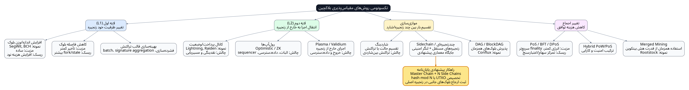
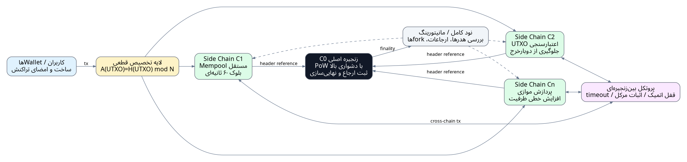

# طراحی و بهینه‌سازی الگوریتم اجماع مقیاس‌پذیر برای سیستم‌های بلاکچین

**Design and Optimization of Scalable Consensus Algorithm for Blockchain Systems**

## مشخصات پایان‌نامه

| فیلد | مقدار |
| --- | --- |
| دانشگاه | دانشگاه تهران |
| دانشکده | دانشکده علوم مهندسی |
| گروه | گروه الگوریتم‌ها و محاسبات |
| رشته | مهندسی کامپیوتر |
| گرایش | الگوریتم‌ها و محاسبات |
| دانشجو | سجاد خشدونی فراهانی |
| استاد راهنما | دکتر علی کمندی |
| تاریخ | فروردین ۱۴۰۵ / April 2026 |

## تقدیم

تقدیم به پدر و مادر عزیزم و به تمام کسانی که به آینده سامانه‌های غیرمتمرکز، شفاف و قابل اعتماد باور دارند.

## سپاسگزاری

سپاس خداوندگار حکیم را که با لطف بی‌کران خود، آدمی را به زیور عقل آراست و توان اندیشیدن، آزمودن و ساختن را در وجود او نهاد.

در آغاز، وظیفه خود می‌دانم از استاد راهنمای گرامی، جناب آقای دکتر علی کمندی، صمیمانه تشکر و قدردانی کنم که در طول انجام این پایان‌نامه با راهنمایی‌های علمی، نقدهای دقیق و حمایت‌های ارزشمند خود مسیر پژوهش را روشن‌تر کردند. همچنین از اعضای محترم گروه الگوریتم‌ها و محاسبات، دوستان و همکارانی که در بحث‌های فنی، آزمون ایده‌ها و بازخوانی متن همراه من بودند سپاسگزارم.

در پایان، از خانواده عزیزم که در تمام مراحل تحصیل و پژوهش با صبر، محبت و حمایت بی‌دریغ خود پشتیبان من بودند، صمیمانه قدردانی می‌کنم.

## چکیده

مقیاس‌پذیری یکی از بنیادی‌ترین چالش‌های فناوری بلاکچین است. در بلاکچین‌های عمومی، هرچه تعداد کاربران، حجم تراکنش‌ها و گستره کاربردها افزایش می‌یابد، فشار بیشتری بر لایه اجماع، شبکه همتا‌به‌همتا، حافظه موقت تراکنش‌ها و ظرفیت ذخیره‌سازی نودها وارد می‌شود. بیتکوین به عنوان نخستین نمونه موفق پول الکترونیکی غیرمتمرکز، امنیت و مقاومت در برابر سانسور را با استفاده از اثبات کار و زنجیره‌ای از بلوک‌های هش‌شده فراهم کرده است؛ اما معماری تک‌زنجیره‌ای آن با فاصله بلوک حدود ۱۰ دقیقه و محدودیت اندازه/وزن بلوک، توان عملیاتی محدودی ایجاد می‌کند. همین محدودیت باعث شده است که استفاده از بیتکوین به عنوان زیرساخت پرداخت جهانی یا سامانه‌ای با بار تراکنشی بالا، بدون راهکارهای مکمل، دشوار باشد.

در این پایان‌نامه، معماری چندزنجیره‌ای مبتنی بر «زنجیره اصلی» و «زنجیره‌های جانبی موازی» برای افزایش توان عملیاتی تراکنش‌ها ارائه می‌شود. ایده اصلی آن است که زنجیره اصلی با اجماع اثبات کار و سطح امنیت بالا نقش لنگر امنیتی، زمان‌سنج و محل ثبت ارجاعات را بر عهده داشته باشد؛ در حالی که زنجیره‌های جانبی با زمان تولید بلوک کوتاه‌تر، تراکنش‌های کاربران را به صورت موازی پردازش کنند. برای جلوگیری از دوبارخرج، تراکنش‌ها بر اساس تابع تخصیص قطعی مبتنی بر هش UTXO به زنجیره‌های جانبی نگاشت می‌شوند. هر زنجیره جانبی دارای mempool و فرایند اعتبارسنجی مستقل است و هدر یا تعهد رمزنگاری‌شده بلوک‌های جانبی به طور دوره‌ای در زنجیره اصلی ثبت می‌شود. در نتیجه، قطعیت نهایی از زنجیره اصلی و تأیید اولیه سریع‌تر از زنجیره‌های جانبی حاصل می‌شود.

در این پژوهش، ابتدا مبانی بلاکچین، مدل UTXO، اجماع ناکاموتو، اثبات کار، زنجیره‌های جانبی، شاردینگ، کانال‌های پرداخت، رول‌آپ‌ها و تغییرات لایه اول بررسی می‌شود. سپس معماری پیشنهادی به صورت رسمی مدل‌سازی شده و اجزای آن شامل تابع تخصیص، ساختار بلوک‌ها، پروتکل پردازش تراکنش، ثبت ارجاع، مکانیزم تراکنش بین‌زنجیره‌ای، تحلیل امنیت و مدل مقیاس‌پذیری تشریح می‌گردد. نتایج آزمایش‌ها با پیاده‌سازی Rust نشان می‌دهد که پیاده‌سازی در محیط آزمایش از نظر ظرفیت محاسباتی، توان پردازش قابل توجهی دارد؛ با این حال، برای پرهیز از اغراق، نتایج بنچمارک محاسباتی از ظرفیت واقعی شبکه تفکیک می‌شود. مدل تئوری نشان می‌دهد که در صورت ثابت بودن اندازه بلوک و فاصله بلوک زنجیره‌های جانبی، ظرفیت کل تقریباً به صورت خطی با تعداد زنجیره‌های جانبی افزایش می‌یابد.

دستاورد اصلی پایان‌نامه، ارائه چارچوبی است که میان سه هدف امنیت، غیرمتمرکز بودن و مقیاس‌پذیری تعادل برقرار می‌کند. معماری پیشنهادی نیازمند بازطراحی کامل زنجیره اصلی نیست و می‌تواند به عنوان یک لایه چندزنجیره‌ای سازگار با مدل UTXO مطالعه شود. با وجود این، چالش‌هایی مانند امنیت زنجیره‌های جانبی با دشواری پایین‌تر، سربار هماهنگی، تراکنش‌های بین‌زنجیره‌ای، داده‌دسترسی، و هزینه اجرای نود کامل باید در طراحی نهایی و توسعه‌های آینده مورد توجه قرار گیرد.

**کلمات کلیدی:** بلاکچین، مقیاس‌پذیری، زنجیره جانبی، زنجیره اصلی، اثبات کار، UTXO، اجماع ناکاموتو، تراکنش در ثانیه، پردازش موازی، سیستم‌های توزیع‌شده.

## Abstract

Scalability is one of the most fundamental challenges in blockchain technology. Public blockchains provide decentralization, transparency, and resistance to censorship, but they typically achieve these properties by requiring many independent nodes to validate and replicate the same transaction history. Bitcoin, as the first successful decentralized electronic cash system, relies on proof-of-work and a hash-linked chain of blocks. However, its single-chain architecture, ten-minute average block interval, and block size/weight constraints lead to limited transaction throughput.

This thesis proposes a scalable multi-chain architecture based on a master chain and multiple parallel side chains. The master chain uses proof-of-work as a security anchor and records cryptographic references to side-chain blocks, while side chains process user transactions in parallel with shorter block intervals. A deterministic UTXO-based assignment function maps each transaction to a side chain, reducing the risk of double spending and enabling independent mempools and validation pipelines. The proposed design separates fast preliminary confirmation from final security anchoring: side chains provide low-latency inclusion, while the master chain provides finality through accumulated proof-of-work.

The thesis reviews blockchain fundamentals, Nakamoto consensus, proof-of-work, UTXO validation, sidechains, payment channels, rollups, sharding, and layer-one scaling techniques. It then formally models the proposed architecture, defines correctness properties, analyzes security assumptions, and evaluates scalability using both theoretical formulas and a Rust-based prototype. The evaluation distinguishes between computational benchmark throughput and realistic network throughput under block size and propagation constraints. The theoretical model shows that, under symmetric side-chain parameters, total throughput increases approximately linearly with the number of side chains.

The main contribution is a structured architecture for improving blockchain throughput while preserving a high-security proof-of-work anchor. The design is not free of limitations: side-chain security, cross-chain transactions, coordination overhead, data availability, and full-node resource requirements remain important challenges. Nevertheless, the proposed architecture provides a useful foundation for future research on scalable, UTXO-compatible blockchain systems.

**Keywords:** Blockchain, Scalability, Sidechains, Master Chain, Proof of Work, UTXO, Nakamoto Consensus, Transactions Per Second, Parallel Processing, Distributed Systems.

# فصل اول: مقدمه

## ۱-۱. مقدمه کلی

بلاکچین را می‌توان یکی از مهم‌ترین نوآوری‌های ترکیبی در حوزه سامانه‌های توزیع‌شده، رمزنگاری کاربردی و اقتصاد شبکه دانست. این فناوری با کنار هم قرار دادن چند ایده شناخته‌شده مانند امضای دیجیتال، تابع هش رمزنگاری، زنجیره بلوکی، شبکه همتا‌به‌همتا، انگیزه اقتصادی و اجماع توزیع‌شده، امکان نگهداری یک دفترکل مشترک بدون متولی مرکزی را فراهم می‌کند. در چنین سامانه‌ای، کاربران برای انتقال ارزش یا ثبت وضعیت نیازی ندارند به بانک، شرکت پرداخت، مرکز داده یا سرور قابل اعتماد واحدی تکیه کنند؛ بلکه اعتبار وضعیت سامانه از قواعد رمزنگاری و توافق جمعی نودها حاصل می‌شود.

بیتکوین نخستین نمونه موفق و پایدار این رویکرد است. در طراحی بیتکوین، تراکنش‌ها به صورت عمومی اعلام می‌شوند، نودها اعتبار آن‌ها را بررسی می‌کنند، ماینرها تراکنش‌های معتبر را در بلوک قرار می‌دهند، و با حل یک مسئله اثبات کار، بلوک پیشنهادی خود را به شبکه ارائه می‌کنند. زنجیره‌ای که بیشترین کار انباشته را در خود دارد به عنوان تاریخچه معتبرتر پذیرفته می‌شود. این مدل باعث می‌شود تغییر یک تراکنش قدیمی بسیار پرهزینه باشد، زیرا مهاجم باید کار محاسباتی بلوک هدف و تمام بلوک‌های بعد از آن را دوباره انجام دهد و از مجموع توان محاسباتی نودهای صادق پیشی بگیرد.

با وجود موفقیت امنیتی و اقتصادی بیتکوین، معماری آن از دید مقیاس‌پذیری محدود است. در یک زنجیره عمومی کاملاً تکرارشونده، همه نودهای کامل باید تمام تراکنش‌ها را دریافت، ذخیره و اعتبارسنجی کنند. این ویژگی، اگرچه برای امنیت و استقلال نودها ضروری است، نرخ پردازش تراکنش را محدود می‌کند. به بیان ساده، اگر ظرفیت هر بلوک محدود باشد و بلوک‌ها با فاصله زمانی نسبتاً زیاد تولید شوند، تعداد تراکنش‌های قابل پردازش در واحد زمان نیز محدود خواهد بود. این مسئله به ویژه در زمان افزایش تقاضا خود را نشان می‌دهد: تراکنش‌ها در mempool انباشته می‌شوند، کاربران برای ورود سریع‌تر به بلوک کارمزد بیشتری پیشنهاد می‌کنند، و کاربردهایی مانند پرداخت خرد، بازی‌های بلاکچینی، اینترنت اشیا و بازارهای مالی پرسرعت با مشکل مواجه می‌شوند.

در نتیجه، پرسش اصلی این پایان‌نامه چنین است: چگونه می‌توان توان عملیاتی بلاکچین را افزایش داد، بدون آنکه امنیت زنجیره اصلی و اصل غیرمتمرکز بودن به طور جدی قربانی شود؟ پاسخ پیشنهادی این پژوهش، استفاده از معماری چندزنجیره‌ای است که در آن زنجیره اصلی نقش امنیتی و هماهنگ‌کننده دارد و چندین زنجیره جانبی مستقل، پردازش تراکنش‌ها را موازی می‌کنند.

## ۱-۲. بیان مسئله

مسئله مقیاس‌پذیری در بلاکچین فقط یک مسئله مربوط به افزایش سرعت برنامه‌نویسی یا ارتقای سخت‌افزار نیست؛ بلکه مسئله‌ای سیستمی و چندبعدی است. در سامانه‌های متمرکز، افزایش ظرفیت معمولاً با اضافه کردن سرور، استفاده از پایگاه‌داده توزیع‌شده، افزایش پهنای باند یا بهینه‌سازی نرم‌افزار انجام می‌شود. اما در بلاکچین‌های عمومی، هر تغییر در ظرفیت باید با ملاحظات امنیتی و تمرکززدایی همراه باشد. اگر اندازه بلوک بسیار بزرگ شود، فقط نودهایی با منابع سخت‌افزاری و شبکه‌ای قوی می‌توانند کل زنجیره را نگهداری کنند. اگر فاصله بلوک بسیار کوتاه شود، احتمال انتشار دیرهنگام بلوک‌ها، ایجاد forkهای موقت و افزایش نرخ بلوک‌های stale بالا می‌رود. اگر اجماع به تعداد کمی اعتبارسنج واگذار شود، توان عملیاتی افزایش می‌یابد، اما شبکه به سمت اعتماد به گروه کوچک‌تری از بازیگران حرکت می‌کند.

در بیتکوین، ظرفیت لایه پایه تابعی از سه عامل کلیدی است: اندازه یا وزن بلوک، میانگین اندازه تراکنش، و فاصله زمانی تولید بلوک. اگر اندازه متوسط هر تراکنش را حدود چند صد بایت و فاصله بلوک را ۶۰۰ ثانیه در نظر بگیریم، ظرفیت نظری لایه پایه در حد چند تراکنش در ثانیه باقی می‌ماند. SegWit با معرفی مفهوم وزن بلوک، ظرفیت مؤثر را بهتر کرد، اما ماهیت تک‌زنجیره‌ای و تکرار کامل اعتبارسنجی در همه نودها همچنان پابرجاست. بنابراین، حتی بهبودهای لایه اول نیز معمولاً با سقف‌های عملی مواجه می‌شوند.

از سوی دیگر، کاربردهای امروزی بلاکچین بسیار فراتر از انتقال ساده ارزش هستند. پرداخت خرد، تسویه بین صرافی‌ها، قراردادهای هوشمند، سیستم‌های رأی‌گیری، زنجیره تأمین، هویت دیجیتال، دارایی‌های توکنیزه‌شده و برنامه‌های مالی غیرمتمرکز نیازمند ظرفیت بالاتر، تأخیر کمتر و تجربه کاربری بهتر هستند. در چنین شرایطی، اگر کاربر برای تأیید اولیه یک پرداخت خرد چند ده دقیقه منتظر بماند یا کارمزد او از ارزش خود تراکنش بیشتر شود، کاربردپذیری سامانه کاهش می‌یابد.

راهکارهای متعددی برای حل مسئله ارائه شده‌اند: افزایش اندازه بلوک، کاهش فاصله بلوک، شبکه لایتنینگ، زنجیره‌های جانبی، شاردینگ، رول‌آپ‌ها و تغییر الگوریتم اجماع. هر یک از این رویکردها بخشی از مسئله را حل می‌کنند، اما هزینه‌ها و فرض‌های خاص خود را دارند. افزایش اندازه بلوک ساده است، اما هزینه اجرای نود کامل را افزایش می‌دهد. شبکه لایتنینگ برای پرداخت‌های تکرارشونده و خرد بسیار مفید است، اما نیازمند مدیریت کانال و نقدینگی است. شاردینگ ظرفیت را افزایش می‌دهد، اما تراکنش‌های بین‌شاردی و امنیت هر شارد را پیچیده می‌کند. رول‌آپ‌ها در اکوسیستم اتریوم نقش مهمی یافته‌اند، اما به زیرساخت اثبات، داده‌دسترسی و اغلب sequencer وابسته‌اند. زنجیره‌های جانبی انعطاف‌پذیرند، اما باید مسئله اتصال، پل، امنیت و اعتماد را حل کنند.

مسئله این پایان‌نامه در همین نقطه شکل می‌گیرد: طراحی معماری‌ای که با حفظ یک زنجیره اصلی امن، پردازش تراکنش را به چند زنجیره موازی تقسیم کند؛ به‌گونه‌ای که هر زنجیره جانبی فقط بخشی از تراکنش‌ها را پردازش کند، اما نتیجه پردازش از طریق ارجاع رمزنگاری‌شده به زنجیره اصلی متصل شود. در این طرح، زنجیره اصلی همچنان محل امنیت نهایی و توافق جهانی است، ولی همه تراکنش‌ها مستقیماً در آن نوشته نمی‌شوند. این جداسازی نقش‌ها می‌تواند گلوگاه تک‌زنجیره‌ای را کاهش دهد.

## ۱-۳. اهمیت و ضرورت پژوهش

اهمیت این پژوهش از چند جنبه قابل بررسی است. نخست، از دید نظری، مسئله مقیاس‌پذیری بلاکچین یکی از نمونه‌های مهم تعارض میان امنیت، کارایی و عدم تمرکز است. طراحی هر راهکار مقیاس‌پذیر باید به این پرسش پاسخ دهد که کدام بخش از بار پردازشی کاهش می‌یابد، کدام فرض امنیتی اضافه می‌شود، و کدام بازیگر جدید ممکن است به نقطه تمرکز تبدیل شود. بنابراین، حتی اگر یک معماری به عدد TPS بالایی برسد، بدون تحلیل امنیت و مدل اعتماد، نمی‌توان آن را راهکار کامل دانست.

دوم، از دید کاربردی، پذیرش گسترده بلاکچین بدون ظرفیت کافی امکان‌پذیر نیست. سامانه‌های پرداخت سنتی، پایگاه‌های داده بانکی، شبکه‌های کارت و زیرساخت‌های مالی متمرکز ظرفیت تراکنشی بالاتری نسبت به بسیاری از بلاکچین‌های عمومی دارند. اگر بلاکچین قرار باشد در کاربردهای عمومی و پرترافیک مورد استفاده قرار گیرد، باید بتواند حداقل بخشی از فاصله عملکردی با این سامانه‌ها را جبران کند.

سوم، از دید مهندسی نرم‌افزار، پیاده‌سازی یک معماری چندزنجیره‌ای فرصت مناسبی برای بررسی عملی محدودیت‌های تئوری است. بسیاری از طرح‌های مقیاس‌پذیری در سطح فرمول، افزایش خطی ظرفیت را نشان می‌دهند؛ اما در پیاده‌سازی واقعی، سربار هماهنگی، مدیریت حافظه، رقابت بین threadها، انتشار شبکه‌ای بلوک‌ها و هزینه اعتبارسنجی امضاها باعث می‌شود ظرفیت عملی کمتر از مقدار نظری باشد. این پایان‌نامه تلاش می‌کند میان مدل نظری و بنچمارک عملی تفکیک قائل شود.

## ۱-۴. چالش سه‌گانه مقیاس‌پذیری، امنیت و غیرمتمرکز بودن

در ادبیات بلاکچین، معمولاً از اصطلاح «سه‌گانه بلاکچین» برای توصیف تعارض میان سه ویژگی استفاده می‌شود: مقیاس‌پذیری، امنیت و غیرمتمرکز بودن. مقصود از مقیاس‌پذیری، توان شبکه برای افزایش ظرفیت با رشد کاربران و تراکنش‌هاست. امنیت به مقاومت سامانه در برابر دوبارخرج، بازنویسی تاریخچه، سانسور و حملات اجماع اشاره دارد. غیرمتمرکز بودن نیز به امکان مشارکت تعداد زیادی نود مستقل در اعتبارسنجی و تصمیم‌گیری مربوط است.

در بیتکوین، امنیت و غیرمتمرکز بودن بر ظرفیت ترجیح داده شده‌اند. فاصله بلوک طولانی و محدودیت اندازه بلوک باعث می‌شود نودهای بیشتری بتوانند شبکه را دنبال کنند و احتمال forkهای مکرر کاهش یابد. اما همین انتخاب‌ها ظرفیت را محدود می‌کنند. در مقابل، برخی زنجیره‌ها با کاهش شدید فاصله بلوک یا افزایش اندازه بلوک، توان عملیاتی بیشتری ارائه می‌دهند؛ ولی ممکن است نیاز سخت‌افزاری نودها افزایش یابد یا تمرکز تولید بلوک بیشتر شود. هدف معماری پیشنهادی این پایان‌نامه آن نیست که این سه‌گانه را به طور کامل حذف کند، بلکه می‌کوشد با تقسیم نقش‌ها، فشار تراکنشی را از زنجیره اصلی کم کند و همچنان از امنیت زنجیره اصلی به عنوان لنگر نهایی استفاده نماید.

## ۱-۵. اهداف پژوهش

هدف اصلی این پایان‌نامه، طراحی و ارزیابی یک معماری اجماع و پردازش تراکنش مقیاس‌پذیر برای بلاکچین‌های مبتنی بر مدل UTXO است. اهداف ویژه عبارت‌اند از:

1. ارائه معماری چندزنجیره‌ای مبتنی بر زنجیره اصلی و چند زنجیره جانبی موازی.
2. تعریف تابع تخصیص قطعی برای نگاشت تراکنش‌ها یا UTXOها به زنجیره‌های جانبی.
3. حفظ نقش امنیتی زنجیره اصلی از طریق ثبت ارجاع بلوک‌های جانبی در آن.
4. کاهش تأخیر تأیید اولیه از طریق تولید بلوک سریع‌تر در زنجیره‌های جانبی.
5. تحلیل تئوری مقیاس‌پذیری افقی و رابطه TPS با تعداد زنجیره‌های جانبی.
6. پیاده‌سازی نمونه اولیه در زبان Rust و بررسی ظرفیت محاسباتی آن.
7. شناسایی محدودیت‌ها، ریسک‌های امنیتی و مسیرهای توسعه آینده.

## ۱-۶. پرسش‌های پژوهش

پرسش‌های اصلی پژوهش به صورت زیر تعریف می‌شوند:

- چگونه می‌توان پردازش تراکنش‌ها را بین چند زنجیره جانبی تقسیم کرد، بدون آنکه خطر دوبارخرج به شکل غیرقابل کنترل افزایش یابد؟
- نقش زنجیره اصلی در معماری چندزنجیره‌ای پیشنهادی چیست و چگونه می‌تواند به عنوان لنگر امنیتی عمل کند؟
- رابطه تعداد زنجیره‌های جانبی با توان عملیاتی کل سیستم چگونه است؟
- چه تفاوتی میان TPS نظری شبکه و TPS بنچمارک محاسباتی پیاده‌سازی وجود دارد؟
- مهم‌ترین ریسک‌های امنیتی، مهندسی و عملیاتی معماری پیشنهادی کدام‌اند؟

## ۱-۷. نوآوری و سهم پژوهش

سهم پژوهش در چند محور قابل بیان است. نخست، یک چارچوب مفهومی و رسمی برای ترکیب زنجیره اصلی PoW با چند زنجیره جانبی موازی ارائه می‌شود. دوم، از تابع تخصیص مبتنی بر هش UTXO برای توزیع تراکنش‌ها استفاده می‌شود تا هر UTXO به یک قلمرو اعتبارسنجی مشخص تعلق گیرد. سوم، مدل ریاضی توان عملیاتی ارائه می‌شود که نشان می‌دهد تحت فرض‌های تقارنی، ظرفیت کل با تعداد زنجیره‌ها رشد خطی دارد. چهارم، پیاده‌سازی نمونه اولیه در Rust انجام شده و نتایج آن به صورت تفکیک‌شده از مدل نظری تحلیل می‌شود. پنجم، برخلاف نگارش‌های کوتاه که صرفاً عدد TPS را گزارش می‌کنند، این پایان‌نامه درباره تهدیدهای اعتبار، محدودیت‌های بنچمارک، سربار هماهنگی و ملاحظات امنیتی بحث می‌کند.

## ۱-۸. دامنه و فرضیات پژوهش

این پژوهش بر بلاکچین‌های عمومی یا نیمه‌عمومی مبتنی بر مدل UTXO تمرکز دارد. فرض می‌شود تراکنش‌ها دارای ورودی‌ها و خروجی‌های قابل شناسایی هستند و هر خروجی خرج‌نشده می‌تواند با هش شناسه خود به یک زنجیره جانبی تخصیص یابد. همچنین فرض می‌شود زنجیره اصلی از اثبات کار استفاده می‌کند و قواعد انتخاب زنجیره بر اساس بیشترین کار انباشته است. پیاده‌سازی نمونه اولیه با هدف ارزیابی معماری و ظرفیت محاسباتی انجام شده و جایگزین یک شبکه عمومی تولیدی نیست. بنابراین، نتایج بنچمارک نباید بدون در نظر گرفتن محدودیت‌های شبکه، اندازه بلوک، انتشار بلوک، اعتبارسنجی امضا و رفتار مهاجم به عنوان توان واقعی شبکه تلقی شوند.


## ۱-۱۰. بسط مسئله از منظر صف و گلوگاه

برای فهم دقیق‌تر مسئله مقیاس‌پذیری، می‌توان زنجیره اصلی را مانند یک صف با ظرفیت خروجی محدود در نظر گرفت. تراکنش‌ها از سوی کاربران وارد mempool می‌شوند. ماینرها در هر بازه زمانی یک بلوک با ظرفیت محدود می‌سازند و فقط بخشی از تراکنش‌ها را از صف خارج می‌کنند. اگر نرخ ورود تراکنش‌ها از نرخ خروج بیشتر شود، طول صف افزایش می‌یابد. افزایش طول صف دو پیامد دارد: نخست، تأخیر تأیید تراکنش‌ها بیشتر می‌شود؛ دوم، کاربران برای اولویت گرفتن کارمزد بالاتری پیشنهاد می‌کنند. این پدیده در دوره‌های ازدحام شبکه بیتکوین و اتریوم بارها مشاهده شده است.

از دید نظری صف، اگر \(\lambda\) نرخ ورود تراکنش و \(\mu\) نرخ پردازش زنجیره باشد، زمانی که \(\lambda < \mu\) سیستم پایدار است، اما هرچه \(\lambda\) به \(\mu\) نزدیک‌تر شود، تأخیر متوسط به شکل غیرخطی افزایش می‌یابد. اگر \(\lambda > \mu\) شود، صف بدون کران رشد می‌کند مگر آنکه کاربران از ارسال تراکنش منصرف شوند یا کارمزدها آن‌قدر بالا رود که تقاضا کاهش یابد. بنابراین، مقیاس‌پذیری فقط به معنای داشتن TPS بالاتر در شرایط آزمایشگاهی نیست؛ بلکه به معنای نگه داشتن سیستم در محدوده پایدار تحت بار واقعی است.

معماری پیشنهادی این پایان‌نامه، از دید صف، یک صف مرکزی را به چند صف موازی تبدیل می‌کند. هر زنجیره جانبی mempool مستقل دارد و بخشی از تراکنش‌ها را پردازش می‌کند. اگر توزیع بار میان زنجیره‌ها متعادل باشد، نرخ خروج کل تقریباً برابر مجموع نرخ خروج زنجیره‌های جانبی خواهد بود. این همان مبنای رشد خطی در مدل تئوری است. اما اگر بار نامتعادل شود یا تراکنش‌های بین‌زنجیره‌ای زیاد باشند، بخشی از این مزیت از بین می‌رود. به همین دلیل، در فصل سوم علاوه بر فرمول TPS، بحث تعادل بار و cross-chain نیز اضافه شده است.

## ۱-۱۱. تمایز میان مقیاس‌پذیری عمودی و افقی

در سامانه‌های رایانه‌ای، مقیاس‌پذیری عمودی به معنای افزایش توان یک ماشین یا یک زنجیره است؛ برای مثال افزایش اندازه بلوک، استفاده از سخت‌افزار قوی‌تر یا بهینه‌سازی کد. مقیاس‌پذیری افقی به معنای اضافه کردن واحدهای پردازشی مستقل است؛ مانند افزودن shard، sidechain یا نود پردازشی. در بلاکچین‌های عمومی، مقیاس‌پذیری عمودی محدودیت جدی دارد، زیرا اگر نیاز سخت‌افزاری نود کامل بیش از حد بالا رود، تعداد مشارکت‌کنندگان مستقل کاهش می‌یابد و سامانه به سمت تمرکز حرکت می‌کند.

پیشنهاد این پایان‌نامه در اصل یک راهکار افقی است. به جای اینکه یک زنجیره را بزرگ‌تر و سنگین‌تر کنیم، چند زنجیره جانبی موازی ایجاد می‌کنیم. البته مقیاس‌پذیری افقی نیز رایگان نیست. باید مشخص شود هر زنجیره چه کسی را اعتبارسنج دارد، چگونه با زنجیره اصلی هماهنگ می‌شود، چگونه داده‌های خود را منتشر می‌کند و چگونه از حمله جلوگیری می‌شود. مزیت رویکرد افقی آن است که ظرفیت می‌تواند به صورت مرحله‌ای افزایش یابد و لازم نیست همه نودها در هر لحظه تمام تراکنش‌های همه زنجیره‌ها را پردازش کنند.

## ۱-۱۲. تعریف دقیق‌تر مسئله پژوهش

با توجه به مباحث بالا، مسئله پژوهش را می‌توان به صورت دقیق‌تر چنین بیان کرد: «طراحی معماری بلاکچینی مبتنی بر مدل UTXO که بتواند با استفاده از مجموعه‌ای از زنجیره‌های جانبی موازی، نرخ پردازش تراکنش را نسبت به معماری تک‌زنجیره‌ای افزایش دهد، در حالی که امنیت نهایی تراکنش‌ها از طریق زنجیره اصلی اثبات کار تأمین شود و قواعد تخصیص تراکنش‌ها به زنجیره‌های جانبی به صورت قطعی، عمومی و قابل اعتبارسنجی باشد.»

این تعریف چند قید مهم دارد. نخست، معماری باید UTXO-compatible باشد. دوم، امنیت نهایی باید به زنجیره اصلی متصل باشد. سوم، تخصیص تراکنش نباید به تصمیم متمرکز وابسته باشد. چهارم، افزایش TPS باید با تحلیل محدودیت‌ها همراه باشد. پنجم، پیاده‌سازی باید آن‌قدر دقیق باشد که امکان اندازه‌گیری، بازتولید و نقد فنی فراهم شود.

## ۱-۹. ساختار پایان‌نامه

فصل دوم به مبانی نظری و مرور مطالعات انجام‌شده اختصاص دارد. در این فصل، بیتکوین، اثبات کار، UTXO، لایه دوم، شاردینگ، زنجیره‌های جانبی، رول‌آپ‌ها و روش‌های افزایش ظرفیت بررسی می‌شوند. فصل سوم معماری پیشنهادی را به صورت رسمی و فنی معرفی می‌کند و شامل مدل سیستم، ساختار داده‌ها، الگوریتم‌ها، تحلیل امنیت و مدل مقیاس‌پذیری است. فصل چهارم نتایج پیاده‌سازی و ارزیابی را ارائه می‌دهد و تفاوت میان مدل نظری و بنچمارک عملی را توضیح می‌دهد. فصل پنجم جمع‌بندی، محدودیت‌ها و پیشنهادهای آینده را بیان می‌کند.

# فصل دوم: مروری بر مطالعات انجام‌شده و مبانی نظری

## ۲-۱. مقدمه

برای طراحی یک الگوریتم یا معماری مقیاس‌پذیر در بلاکچین، ابتدا باید روشن شود که محدودیت مقیاس‌پذیری از کجا ناشی می‌شود. بلاکچین تنها یک پایگاه داده توزیع‌شده نیست؛ بلکه پایگاه داده‌ای است که در محیطی باز، ناهمگن، ناهمزمان و بالقوه خصمانه اجرا می‌شود. نودها ممکن است با یکدیگر اعتماد نداشته باشند، مهاجم می‌تواند پیام‌ها را با تأخیر برساند، بخشی از توان محاسباتی شبکه ممکن است رفتار مخرب داشته باشد، و انگیزه اقتصادی بازیگران بر رفتار آن‌ها اثر می‌گذارد. به همین دلیل، راهکارهای معمول مقیاس‌پذیری پایگاه داده مانند shard کردن ساده یا replication متمرکز به تنهایی کافی نیستند.

در این فصل، ابتدا ساختار بلاکچین و بیتکوین به عنوان خط مبنا بررسی می‌شود. سپس روش‌های مختلف مقیاس‌پذیری در قالب یک تکسونومی تحلیل می‌شوند. هدف این فصل صرفاً معرفی فهرست‌وار روش‌ها نیست؛ بلکه نشان دادن جایگاه معماری پیشنهادی در میان خانواده‌های مختلف راهکارهاست.

## ۲-۲. بلاکچین به عنوان دفترکل توزیع‌شده

بلاکچین یک دفترکل append-only است که رکوردها را به صورت بلوک‌های زنجیره‌شده ذخیره می‌کند. هر بلوک معمولاً شامل هدر، فهرست تراکنش‌ها، هش بلوک قبلی، ریشه مرکل تراکنش‌ها، زمان و داده‌های مربوط به اجماع است. اتصال هر بلوک به هش بلوک قبل باعث می‌شود تغییر محتوای یک بلوک، هش آن و در نتیجه هش تمام بلوک‌های بعدی را تغییر دهد. بنابراین، دستکاری تاریخچه بدون بازسازی زنجیره بسیار دشوار می‌شود.

در نودهای کامل، اعتبار یک بلوک فقط به داشتن PoW کافی محدود نیست. نود باید بررسی کند که همه تراکنش‌ها معتبرند، امضاها صحیح‌اند، ورودی‌ها قبلاً خرج نشده‌اند، مقادیر خروجی از ورودی بیشتر نیست، coinbase مطابق قواعد است، و هدر بلوک به زنجیره معتبر متصل است. این اعتبارسنجی کامل یکی از پایه‌های غیرمتمرکز بودن است؛ زیرا هر کاربر می‌تواند مستقل از اعتماد به ماینرها، صحت تاریخچه را بررسی کند.

## ۲-۳. مدل تراکنش UTXO

در مدل UTXO، دارایی به صورت مجموعه‌ای از خروجی‌های خرج‌نشده نمایش داده می‌شود. هر تراکنش، تعدادی خروجی قبلی را به عنوان ورودی مصرف می‌کند و تعدادی خروجی جدید می‌سازد. خروجی‌های جدید تا زمانی که در تراکنش دیگری خرج نشوند، در مجموعه UTXO باقی می‌مانند. اعتبار یک تراکنش وابسته به این است که همه ورودی‌های آن در مجموعه UTXO وجود داشته باشند و قبلاً خرج نشده باشند.

این مدل برای معماری پیشنهادی اهمیت زیادی دارد، زیرا تخصیص تراکنش به زنجیره جانبی بر اساس شناسه UTXO انجام می‌شود. اگر هر UTXO قلمرو مشخصی داشته باشد، می‌توان مسئولیت بررسی دوبارخرج آن را به زنجیره جانبی متناظر سپرد. البته تراکنش‌هایی که چند ورودی از زنجیره‌های مختلف دارند پیچیده‌تر می‌شوند و نیازمند پروتکل بین‌زنجیره‌ای هستند. این نکته در فصل سوم بررسی می‌شود.

## ۲-۴. اجماع ناکاموتو و اثبات کار

اجماع ناکاموتو ترکیبی از انتشار همتا‌به‌همتا، انتخاب زنجیره با بیشترین کار و انگیزه اقتصادی ماینرهاست. در این مدل، ماینرها برای یافتن nonce مناسب رقابت می‌کنند تا هش هدر بلوک از مقدار هدف کمتر شود. دشواری شبکه به گونه‌ای تنظیم می‌شود که میانگین زمان تولید بلوک در حدود مقدار هدف باقی بماند. در بیتکوین، این هدف حدود ۱۰ دقیقه است و دشواری هر ۲۰۱۶ بلوک تنظیم می‌شود.

امنیت PoW از این واقعیت ناشی می‌شود که تولید بلوک هزینه‌بر، اما اعتبارسنجی آن ارزان است. یک مهاجم برای بازنویسی تاریخچه باید زنجیره جایگزینی بسازد که کار انباشته بیشتری از زنجیره صادق داشته باشد. اگر سهم مهاجم از قدرت هش کمتر از نودهای صادق باشد، احتمال رسیدن او به زنجیره اصلی با افزایش تعداد تأییدها کاهش می‌یابد. با وجود این، PoW هزینه انرژی بالایی دارد و اگر قدرت هش در استخرهای استخراج متمرکز شود، ریسک‌های اقتصادی و حاکمیتی ایجاد می‌شود.

## ۲-۵. محدودیت مقیاس‌پذیری بیتکوین

در بیتکوین، هر تراکنش باید در بلوک قرار گیرد، بلوک باید منتشر شود، و نودهای کامل باید آن را اعتبارسنجی کنند. ظرفیت نظری تقریبی را می‌توان چنین نوشت:

$$
TPS \approx \frac{B / \tau}{T}
$$

که در آن، \(B\) اندازه یا ظرفیت مؤثر بلوک، \(\tau\) اندازه متوسط تراکنش و \(T\) فاصله زمانی بلوک است. با افزایش \(B\)، توان عملیاتی زیاد می‌شود، اما هزینه پهنای باند، ذخیره‌سازی و پردازش نودها نیز افزایش می‌یابد. با کاهش \(T\)، تأخیر کمتر می‌شود، اما احتمال همزمانی تولید بلوک و fork موقت بالا می‌رود. بنابراین، ظرفیت بیتکوین فقط محدودیت نرم‌افزاری نیست؛ بلکه نتیجه یک انتخاب طراحی برای حفظ امنیت و امکان اجرای نود کامل است.

SegWit با تغییر نحوه محاسبه وزن بلوک، بخشی از داده witness را با وزن کمتر محاسبه می‌کند و سقف وزن بلوک را چهار میلیون واحد تعریف می‌کند. این تغییر ظرفیت مؤثر را افزایش داد و malleability تراکنش را کاهش داد، اما محدودیت بنیادین تک‌زنجیره‌ای همچنان باقی ماند.

## ۲-۶. شاخص‌های ارزیابی مقیاس‌پذیری

برای مقایسه منصفانه راهکارهای مقیاس‌پذیری، باید چند شاخص همزمان بررسی شود:

- توان عملیاتی یا TPS: تعداد تراکنش‌هایی که شبکه در واحد زمان پردازش می‌کند.
- تأخیر تأیید اولیه: مدت زمانی که کاربر تا مشاهده تراکنش در یک بلوک یا کانال منتظر می‌ماند.
- تأخیر قطعیت نهایی: مدت زمانی که پس از آن بازگشت تراکنش از نظر اقتصادی یا پروتکلی بسیار نامحتمل می‌شود.
- هزینه تراکنش: کارمزدی که کاربر برای ورود به بلوک یا استفاده از لایه دوم پرداخت می‌کند.
- هزینه اجرای نود کامل: منابع ذخیره‌سازی، پردازش، حافظه و پهنای باند مورد نیاز.
- مدل امنیتی: نوع حملات قابل تحمل و فرض‌های اعتماد.
- داده‌دسترسی: امکان دسترسی نودها به داده لازم برای اعتبارسنجی.
- پیچیدگی پیاده‌سازی و تجربه کاربری.

معماری پیشنهادی این پایان‌نامه عمدتاً TPS، تأخیر اولیه و مقیاس‌پذیری افقی را هدف می‌گیرد، اما در تحلیل امنیت و محدودیت‌ها نشان داده می‌شود که این بهبودها بدون هزینه نیستند.

## ۲-۷. راهکارهای لایه اول

راهکارهای لایه اول مستقیماً قواعد زنجیره اصلی را تغییر می‌دهند. ساده‌ترین روش، افزایش اندازه بلوک است. این روش در Bitcoin Cash و برخی انشعاب‌های دیگر دنبال شد. مزیت آن سادگی و سازگاری با تجربه کاربری موجود است: تراکنش همچنان on-chain است و کاربر نیازی به کانال یا پل ندارد. اما با بزرگ‌تر شدن بلوک‌ها، انتشار بلوک زمان بیشتری می‌برد و نودهای کوچک‌تر ممکن است توانایی مشارکت کامل را از دست بدهند.

روش دیگر کاهش فاصله بلوک است. برخی ارزها با زمان بلوک کوتاه‌تر، تأیید اولیه سریع‌تری فراهم می‌کنند. اما اگر فاصله بلوک نسبت به تأخیر انتشار شبکه بسیار کوچک شود، احتمال تولید بلوک‌های رقیب افزایش می‌یابد. این پدیده امنیت مؤثر را کاهش می‌دهد، زیرا بخشی از توان هش صرف بلوک‌هایی می‌شود که در زنجیره نهایی باقی نمی‌مانند.

بهینه‌سازی قالب تراکنش، فشرده‌سازی، batch کردن پرداخت‌ها و استفاده از امضاهای تجمیعی نیز می‌تواند ظرفیت مؤثر را بهتر کند. این روش‌ها مفیدند، اما معمولاً رشد خطی نامحدود ایجاد نمی‌کنند؛ زیرا در نهایت همه تراکنش‌ها باید روی یک زنجیره مشترک ثبت و توسط همه نودها اعتبارسنجی شوند.

## ۲-۸. شبکه لایتنینگ و کانال‌های پرداخت

شبکه لایتنینگ یک راهکار لایه دوم برای پرداخت‌های سریع و کم‌هزینه است. ایده اصلی آن است که دو طرف یک کانال پرداخت با تراکنش on-chain باز کنند، سپس تعداد زیادی تراکنش خارج از زنجیره رد و بدل کنند، و در پایان فقط وضعیت نهایی را روی زنجیره اصلی تسویه کنند. برای پرداخت به کاربری که کانال مستقیم وجود ندارد، پرداخت می‌تواند از مسیر چند کانال و با استفاده از قراردادهای قفل‌شده هش-زمانی منتقل شود.

لایتنینگ بار زیادی را از زنجیره اصلی کم می‌کند و برای پرداخت‌های خرد تکرارشونده بسیار مناسب است. با این حال، محدودیت‌هایی دارد: کانال‌ها نیازمند نقدینگی قفل‌شده هستند، مسیریابی به ظرفیت کانال‌ها وابسته است، کاربران یا سرویس‌های نماینده باید وضعیت کانال را رصد کنند، و تجربه کاربری برای افراد غیرمتخصص پیچیده‌تر از پرداخت on-chain است. از نظر این پایان‌نامه، لایتنینگ یک نمونه مهم از تفکیک اجرای تراکنش از تسویه نهایی است، اما معماری پیشنهادی به جای کانال‌های خصوصی، زنجیره‌های جانبی عمومی و موازی را مبنای مقیاس‌پذیری قرار می‌دهد.

## ۲-۹. رول‌آپ‌ها

رول‌آپ‌ها به ویژه در اکوسیستم اتریوم به راهکار اصلی مقیاس‌پذیری تبدیل شده‌اند. در رول‌آپ، اجرای تراکنش‌ها خارج از لایه اول انجام می‌شود، اما داده یا تعهد مربوط به batch تراکنش‌ها روی لایه اول منتشر می‌شود. در رول‌آپ خوش‌بینانه، تراکنش‌ها معتبر فرض می‌شوند مگر آنکه در دوره چالش، اثبات تقلب ارائه شود. در رول‌آپ دانش صفر، صحت محاسبه با اثبات رمزنگاری‌شده تأیید می‌شود.

مزیت رول‌آپ‌ها آن است که امنیت خود را تا حد زیادی از لایه اول می‌گیرند و می‌توانند هزینه تراکنش را کاهش دهند. چالش‌های آن‌ها شامل هزینه تولید اثبات، تمرکز sequencer، داده‌دسترسی، تأخیر خروج در optimistic rollup و پیچیدگی فنی است. معماری پیشنهادی این پایان‌نامه از نظر ثبت ارجاع در زنجیره اصلی به رول‌آپ‌ها شباهت دارد، اما به جای اجرای batch در یک لایه دوم، چند زنجیره جانبی مستقل با اجماع و mempool جداگانه را در نظر می‌گیرد.

## ۲-۱۰. شاردینگ

شاردینگ از پایگاه‌های داده توزیع‌شده الهام گرفته شده و هدف آن تقسیم بار پردازش و ذخیره‌سازی بین بخش‌های مختلف شبکه است. در بلاکچین، شاردینگ می‌تواند بر اساس حساب، UTXO، قرارداد، وضعیت یا تراکنش انجام شود. هر شارد بخشی از تراکنش‌ها را پردازش می‌کند و به این ترتیب شبکه می‌تواند با افزایش تعداد شاردها ظرفیت بیشتری به دست آورد.

چالش اصلی شاردینگ، امنیت هر شارد و تراکنش‌های بین‌شاردی است. اگر اعتبارسنج‌های هر شارد از زیرمجموعه کوچکی از نودها تشکیل شوند، مهاجم با کنترل بخشی از نودها ممکن است یک شارد را هدف قرار دهد. همچنین، اگر تراکنشی به وضعیت چند شارد وابسته باشد، باید پروتکلی برای atomic commit، قفل‌گذاری یا اثبات متقابل وجود داشته باشد. پژوهش‌هایی مانند Elastico، OmniLedger، Chainspace، RapidChain و دیگر طرح‌های شاردینگ تلاش کرده‌اند این مسائل را با کمیته‌های تصادفی، BFT، beacon chain، پروتکل‌های commit و مکانیزم‌های داده‌دسترسی حل کنند.

## ۲-۱۱. زنجیره‌های جانبی

زنجیره جانبی بلاکچینی است که در کنار زنجیره اصلی اجرا می‌شود و می‌تواند قواعد اجماع، زمان بلوک، قالب تراکنش و قابلیت‌های خاص خود را داشته باشد. اتصال میان زنجیره اصلی و جانبی معمولاً از طریق پل دوطرفه، اثبات SPV، peg فدرال یا قراردادهای قفل‌شونده انجام می‌شود. هدف زنجیره جانبی می‌تواند افزایش ظرفیت، افزودن قابلیت‌های جدید، محرمانگی، قرارداد هوشمند یا تسویه سریع‌تر باشد.

Rootstock نمونه‌ای از زنجیره جانبی بیتکوین است که سازگاری با EVM و merged mining را فراهم می‌کند. Liquid نیز یک شبکه جانبی فدرال برای تسویه سریع‌تر میان صرافی‌ها و مؤسسات است. این نمونه‌ها نشان می‌دهند زنجیره جانبی می‌تواند قابلیت‌های مفیدی به اکوسیستم بیتکوین اضافه کند؛ اما مدل اعتماد آن‌ها متفاوت است. معماری پیشنهادی این پایان‌نامه از مفهوم sidechain استفاده می‌کند، ولی به جای یک زنجیره جانبی واحد یا فدرال، مجموعه‌ای از زنجیره‌های جانبی موازی را برای افزایش ظرفیت تراکنشی در نظر می‌گیرد.

## ۲-۱۲. تغییر الگوریتم اجماع

بعضی بلاکچین‌ها برای افزایش کارایی از اثبات سهام، BFT، DPoS یا مدل‌های ترکیبی استفاده می‌کنند. این روش‌ها می‌توانند قطعیت سریع‌تر و مصرف انرژی کمتر داشته باشند. با این حال، هر کدام فرض‌های خاصی درباره توزیع سهام، تعداد اعتبارسنج‌ها، شبکه، جریمه اقتصادی و حاکمیت دارند. در این پایان‌نامه، هدف جایگزینی کامل PoW نیست؛ زیرا زنجیره اصلی PoW به عنوان لنگر امنیتی در نظر گرفته می‌شود. با وجود این، برای زنجیره‌های جانبی می‌توان در آینده اجماع‌های جایگزین یا ترکیبی را بررسی کرد.

## ۲-۱۳. تکسونومی روش‌های مقیاس‌پذیری

شکل زیر تکسونومی پیشنهادی برای دسته‌بندی روش‌های مقیاس‌پذیری بلاکچین را نشان می‌دهد. در این شکل، معماری پیشنهادی در خانواده «موازی‌سازی/چندزنجیره‌ای» قرار می‌گیرد.



**جدول ۲-۱. مقایسه خانواده‌های مقیاس‌پذیری**

| خانواده | مکانیزم افزایش ظرفیت | نمونه‌ها | مزایا | چالش‌ها |
| --- | --- | --- | --- | --- |
| افزایش ظرفیت L1 | افزایش اندازه/وزن بلوک یا کاهش فاصله بلوک | SegWit, BCH | ساده، on-chain | هزینه نود، fork، تمرکز |
| کانال‌ها | اجرای تراکنش خارج از زنجیره و تسویه نهایی | Lightning | تأخیر کم، کارمزد کم | نقدینگی، رصد کانال، مسیریابی |
| رول‌آپ‌ها | اجرای off-chain و انتشار داده/اثبات در L1 | Optimistic, ZK | امنیت لایه اول، TPS بالا | اثبات، داده‌دسترسی، sequencer |
| شاردینگ | تقسیم حالت/تراکنش بین شاردها | OmniLedger, Chainspace | رشد افقی | امنیت شارد، تراکنش بین‌شاردی |
| زنجیره جانبی | زنجیره مستقل متصل به L1 | Rootstock, Liquid | انعطاف‌پذیری، قابلیت جدید | پل، اعتماد، امنیت جانبی |
| چندزنجیره‌ای پیشنهادی | N زنجیره جانبی موازی + لنگر اصلی | این پایان‌نامه | TPS خطی با N، سازگار با UTXO | هماهنگی، cross-chain، داده‌دسترسی |

## ۲-۱۴. جایگاه معماری پیشنهادی

معماری پیشنهادی میان شاردینگ و زنجیره جانبی قرار می‌گیرد. از شاردینگ، ایده تقسیم بار و پردازش موازی را می‌گیرد. از زنجیره جانبی، استقلال زنجیره‌ها و امکان ثبت ارجاع در زنجیره اصلی را می‌گیرد. تفاوت مهم آن با زنجیره‌های جانبی کلاسیک در این است که تعداد زنجیره‌ها می‌تواند متناسب با بار افزایش یابد و هر زنجیره جانبی بخشی از فضای UTXO را پردازش کند. تفاوت آن با شاردینگ کلاسیک نیز در این است که زنجیره اصلی همچنان لایه امنیتی مشترک و زمان‌سنج عمومی است و نیازی نیست یک ماشین حالت واحد میان همه شاردها بازطراحی شود.

## ۲-۱۵. خلاصه فصل

در این فصل نشان داده شد که مقیاس‌پذیری بلاکچین مسئله‌ای چندبعدی است و هیچ راهکار واحدی بدون هزینه وجود ندارد. افزایش ظرفیت لایه اول ساده است، اما ممکن است هزینه اجرای نود را بالا ببرد. لایتنینگ و رول‌آپ‌ها بار تراکنش را از زنجیره اصلی کم می‌کنند، اما وابستگی‌های جدیدی ایجاد می‌کنند. شاردینگ رشد افقی دارد، اما امنیت شارد و تراکنش بین‌شاردی را پیچیده می‌کند. زنجیره‌های جانبی انعطاف‌پذیرند، اما مدل اعتماد و پل آن‌ها باید دقیق تحلیل شود. معماری پیشنهادی این پایان‌نامه تلاش می‌کند با ترکیب زنجیره اصلی امن و زنجیره‌های جانبی موازی، راهکاری میانی و قابل تحلیل ارائه دهد.


## ۲-۱۶. مروری عمیق‌تر بر مسئله داده‌دسترسی

یکی از مفاهیمی که در متن‌های کوتاه مربوط به مقیاس‌پذیری کمتر به آن توجه می‌شود، «داده‌دسترسی» است. فرض کنید یک زنجیره جانبی فقط هش بلوک خود را در زنجیره اصلی ثبت کند، اما داده کامل تراکنش‌های بلوک را منتشر نکند. در این حالت، نودهای دیگر ممکن است نتوانند بررسی کنند که آیا بلوک جانبی واقعاً شامل تراکنش‌های معتبر بوده یا خیر. بنابراین، ثبت هش به تنهایی برای امنیت کافی نیست؛ زیرا هش فقط تعهد به داده است، نه خود داده.

در رول‌آپ‌ها نیز همین مسئله وجود دارد. اگر داده تراکنش‌ها روی لایه اول منتشر شود، نودها می‌توانند وضعیت را بازسازی کنند. اما اگر فقط یک تعهد یا هش منتشر شود، کاربران برای بازیابی وضعیت به اپراتور یا کمیته داده‌دسترسی وابسته می‌شوند. در معماری پیشنهادی این پایان‌نامه نیز، اگر زنجیره‌های جانبی مستقل باشند، باید روشن شود چه کسی داده بلوک جانبی را نگه می‌دارد، چه کسی آن را منتشر می‌کند، و در صورت عدم انتشار داده چه اتفاقی می‌افتد. برای حل این مسئله، حداقل سه رویکرد وجود دارد: انتشار کامل داده بلوک‌های جانبی در شبکه جانبی، الزام به انتشار داده قبل از پذیرش ارجاع در زنجیره اصلی، یا استفاده از روش‌های پیشرفته‌تر مانند تعهدهای erasure coding و نمونه‌برداری داده‌دسترسی.

برای نسخه اولیه پایان‌نامه، لازم نیست یک سیستم کامل data availability sampling پیاده‌سازی شود؛ اما باید مسئله به عنوان یک محدودیت بنیادی مطرح شود. این کار باعث می‌شود متن از حالت ادعایی خارج شود و نشان دهد پژوهشگر نسبت به مرزهای واقعی طراحی آگاه است. در فصل سوم، سیاست پیشنهادی این است که ارجاع بلوک جانبی فقط زمانی در زنجیره اصلی پذیرفته شود که هدر بلوک، ریشه مرکل، اندازه داده و نشانی انتشار داده جانبی مشخص باشد. در توسعه‌های آینده، می‌توان یک لایه نمونه‌برداری سبک برای نودهایی طراحی کرد که نمی‌خواهند همه داده‌های جانبی را دانلود کنند.

## ۲-۱۷. مدل‌های پل و انتقال دارایی میان زنجیره‌ها

زنجیره جانبی بدون مکانیزم انتقال دارایی، بیشتر شبیه یک بلاکچین مستقل است تا راهکاری برای مقیاس‌پذیری زنجیره اصلی. بنابراین، پل یا peg بخش مهمی از طراحی sidechain است. در ساده‌ترین مدل، کاربر دارایی را در زنجیره اصلی قفل می‌کند و معادل آن در زنجیره جانبی صادر می‌شود. هنگام بازگشت، دارایی جانبی سوزانده یا قفل می‌شود و دارایی اصلی آزاد می‌گردد. مسئله اصلی آن است که زنجیره مقصد چگونه مطمئن می‌شود رویداد قفل یا سوزاندن واقعاً رخ داده است.

در مدل SPV peg، زنجیره مقصد با استفاده از هدرهای بلوک و اثبات مرکل، وجود تراکنش قفل را بررسی می‌کند. این مدل از نظر اعتماد جذاب است، اما در بیتکوین کلاسیک پیاده‌سازی کامل آن دشوار است و نیاز به تغییرات پروتکلی یا محدودیت‌های اسکریپت دارد. در مدل فدرال، گروهی از امضاکنندگان مورد اعتماد انتقال را تأیید می‌کنند. این روش عملی‌تر است، اما اعتماد به federation را اضافه می‌کند. در مدل smart-contract-based، قرارداد هوشمند روی زنجیره اصلی نقش پل را بازی می‌کند، اما این مدل در بیتکوین به دلیل محدودیت زبان اسکریپت ساده نیست.

معماری پیشنهادی این پایان‌نامه از پل به معنای انتقال آزاد دارایی میان اکوسیستم‌های مستقل شروع نمی‌کند؛ بلکه فرض می‌کند زنجیره‌های جانبی بخشی از یک سامانه مشترک هستند و UTXOها با تابع تخصیص به آن‌ها نگاشت می‌شوند. این فرض، طراحی را ساده‌تر می‌کند، اما اگر قرار باشد معماری در یک شبکه عمومی و قابل تعامل با بیتکوین واقعی پیاده شود، طراحی پل و مدل اعتماد باید به شکل جداگانه تکمیل گردد.

## ۲-۱۸. مقایسه شاردینگ و چندزنجیره‌ای از منظر consistency

شاردینگ و چندزنجیره‌ای هر دو به دنبال تقسیم بار هستند، اما از نظر consistency تفاوت دارند. در شاردینگ کلاسیک، معمولاً هدف آن است که کل سامانه همچنان یک ماشین حالت منطقی واحد باقی بماند. بنابراین، اگر تراکنشی به چند شارد وابسته باشد، پروتکل باید تضمین کند یا همه تغییرات اعمال شوند یا هیچ‌کدام. این مسئله مشابه atomic commit در پایگاه داده توزیع‌شده است، اما به دلیل احتمال رفتار بیزانسی نودها بسیار دشوارتر می‌شود.

در معماری چندزنجیره‌ای، هر زنجیره می‌تواند استقلال بیشتری داشته باشد. اگر دارایی‌ها یا حساب‌ها کاملاً از هم جدا باشند، consistency بین‌زنجیره‌ای کمتر مورد نیاز است. اما در سامانه مالی مشترک، کاربران انتظار دارند بتوانند دارایی را میان زنجیره‌ها جابه‌جا کنند یا تراکنش‌هایی با ورودی‌های چندگانه بسازند. بنابراین، معماری چندزنجیره‌ای نیز در نهایت به مسئله cross-chain consistency می‌رسد.

راهکار پیشنهادی این پایان‌نامه برای نسخه اولیه، محدودسازی تراکنش‌های چندزنجیره‌ای و طراحی مسیر استاندارد برای آن‌هاست. به عبارت دیگر، تراکنش‌های ساده تک‌زنجیره‌ای باید سریع و ارزان باشند، اما تراکنش‌های پیچیده بین‌زنجیره‌ای می‌توانند تأخیر بیشتر و کارمزد بالاتر داشته باشند. این تفکیک در بسیاری از سامانه‌های مقیاس‌پذیر طبیعی است: مسیر رایج بهینه می‌شود و مسیر پیچیده با پروتکل قوی‌تر ولی پرهزینه‌تر مدیریت می‌شود.

## ۲-۱۹. معیارهای امنیتی در طراحی اجماع مقیاس‌پذیر

هر طرح اجماع یا مقیاس‌پذیری باید دست‌کم سه خاصیت را مشخص کند: safety، liveness و validity. Safety به این معناست که دو نود صادق به دو تاریخچه ناسازگار نهایی نرسند. Liveness یعنی تراکنش‌های معتبر در نهایت پردازش شوند. Validity یعنی بلوک‌ها و تراکنش‌های نامعتبر پذیرفته نشوند. در PoW بیتکوین، safety احتمالاتی است و با افزایش تعداد تأییدها قوی‌تر می‌شود. در BFTهای کلاسیک، finality می‌تواند قطعی باشد، اما معمولاً تعداد اعتبارسنج‌ها محدودتر است.

در معماری پیشنهادی، safety در دو سطح تعریف می‌شود. در سطح جانبی، نودهای هر زنجیره جانبی نباید درباره خرج شدن UTXOهای آن زنجیره به وضعیت ناسازگار برسند. در سطح اصلی، زنجیره اصلی باید درباره ترتیب ارجاعات جانبی توافق کند. اگر بلوک جانبی بدون ارجاع در زنجیره اصلی باشد، تأیید آن هنوز نهایی نیست. بنابراین، تعریف finality در این معماری دو مرحله‌ای است و باید در متن پایان‌نامه به صورت صریح بیان شود.


## ۲-۲۱. نقش Merkle Tree و اثبات‌های عضویت

در بلاکچین، درخت مرکل یکی از ابزارهای کلیدی برای کاهش هزینه اثبات است. به جای آنکه برای اثبات وجود یک تراکنش، کل بلوک ارسال شود، کافی است مسیر مرکل از تراکنش تا ریشه درخت ارسال گردد. اگر ریشه مرکل در هدر بلوک ذخیره شده باشد، دریافت‌کننده می‌تواند با چند هش، عضویت تراکنش را بررسی کند. این ایده برای معماری پیشنهادی بسیار مهم است، زیرا زنجیره اصلی قرار نیست همه تراکنش‌های جانبی را ذخیره کند؛ بلکه می‌تواند ریشه مرکل بلوک‌های جانبی را نگه دارد.

اگر کاربر بخواهد اثبات کند تراکنش او در زنجیره جانبی قرار گرفته و آن بلوک در زنجیره اصلی ارجاع شده است، باید دو اثبات داشته باشد: اثبات عضویت تراکنش در بلوک جانبی و اثبات ثبت هش بلوک جانبی در بلوک اصلی. به این ترتیب، یک زنجیره اعتماد دو مرحله‌ای ساخته می‌شود. این مدل شبیه SPV است، اما با یک لایه اضافه. مزیت آن کاهش حجم داده برای کاربران سبک است؛ محدودیت آن این است که کاربر سبک همچنان همه قواعد اعتبارسنجی تراکنش را اجرا نمی‌کند و به نودهای کامل برای کشف بلوک نامعتبر وابسته است.

## ۲-۲۲. BlockDAG و پردازش بلوک‌های همزمان

یکی دیگر از مسیرهای مقیاس‌پذیری، تغییر ساختار زنجیره از یک خط به گراف جهت‌دار بدون دور یا BlockDAG است. در بیتکوین، اگر دو ماینر تقریباً همزمان بلوک بسازند، یکی از بلوک‌ها در نهایت stale می‌شود و کار محاسباتی آن در تاریخچه اصلی استفاده نمی‌شود. در BlockDAG، تلاش می‌شود چند بلوک همزمان به جای حذف شدن، در ساختار اجماع لحاظ شوند. این رویکرد می‌تواند throughput را افزایش دهد، زیرا بلوک‌های موازی کمتر دور ریخته می‌شوند.

با این حال، BlockDAG نیازمند قواعد پیچیده برای مرتب‌سازی تراکنش‌ها و حل تعارض دوبارخرج است. اگر دو بلوک همزمان تراکنش‌های ناسازگار داشته باشند، پروتکل باید تصمیم بگیرد کدام تراکنش معتبر است. معماری پیشنهادی این پایان‌نامه مسیر متفاوتی را انتخاب می‌کند: به جای پذیرش بلوک‌های همزمان در یک DAG مشترک، چند زنجیره جانبی مستقل تعریف می‌کند که هر کدام قلمرو UTXO مشخصی دارند. به این ترتیب، تعارض‌ها تا حد ممکن محلی می‌شوند.

## ۲-۲۳. مقایسه با معماری rollup-centric اتریوم

اتریوم در مسیر مقیاس‌پذیری خود به سمت معماری rollup-centric حرکت کرده است. در این رویکرد، لایه اول به جای اجرای مستقیم همه تراکنش‌ها، بیشتر نقش امنیت، داده‌دسترسی و تسویه را برای rollupها بازی می‌کند. این ایده از نظر فلسفه طراحی به معماری پیشنهادی نزدیک است: لایه اصلی نباید همه بار اجرا را تحمل کند. تفاوت اصلی در این است که rollupها معمولاً batch تراکنش‌ها را با اثبات یا امکان challenge به لایه اول متصل می‌کنند، در حالی که معماری پیشنهادی از زنجیره‌های جانبی مستقل و مدل UTXO استفاده می‌کند.

این مقایسه از نظر پایان‌نامه مهم است، زیرا نشان می‌دهد ایده جداسازی اجرا از امنیت نهایی در اکوسیستم‌های بزرگ نیز پذیرفته شده است. با این حال، نمی‌توان به سادگی مدل اتریوم را به بیتکوین منتقل کرد، زیرا بیتکوین زبان اسکریپت محدودتر، مدل UTXO و فلسفه محافظه‌کارانه‌تری در تغییر لایه اول دارد. بنابراین، راهکار UTXO-compatible و کم‌تغییر می‌تواند برای پژوهش روی بیتکوین و زنجیره‌های مشابه ارزشمند باشد.

## ۲-۲۴. درس‌هایی از پایان‌نامه‌های مشابه

بررسی پایان‌نامه‌های فنی مرتبط نشان می‌دهد متن دفاع‌پذیر معمولاً فقط شامل معرفی روش نیست، بلکه سه لایه مکمل دارد: لایه مفهومی، لایه پیاده‌سازی و لایه ارزیابی. در لایه مفهومی، نویسنده باید مسئله، فرض‌ها، متغیرها و معیارها را دقیق تعریف کند. در لایه پیاده‌سازی، باید ساختار ماژول‌ها، داده‌ها، الگوریتم‌ها و انتخاب‌های مهندسی توضیح داده شود. در لایه ارزیابی، باید نتایج با baselineها مقایسه شوند و محدودیت‌ها صادقانه بیان گردند.

نسخه اولیه متن پایان‌نامه حاضر بیشتر بر ایده کلی و چند عدد TPS تمرکز داشت. در نسخه توسعه‌یافته، تلاش شده این سه لایه کامل‌تر شود: فصل اول مسئله را از منظر سیستم، صف و سه‌گانه بلاکچین بسط می‌دهد؛ فصل دوم ادبیات را با تاکسونومی و مقایسه انتقادی سازمان می‌دهد؛ فصل سوم معماری را با مدل رسمی، تابع تخصیص، cross-chain، داده‌دسترسی و انگیزه اقتصادی توضیح می‌دهد؛ فصل چهارم میان ظرفیت نظری و بنچمارک محاسباتی تمایز می‌گذارد.

## ۲-۲۰. جمع‌بندی انتقادی ادبیات

مرور ادبیات نشان می‌دهد هر خانواده راهکار، مسئله مقیاس‌پذیری را از زاویه‌ای متفاوت حل می‌کند. لایه اول ظرفیت خود زنجیره را افزایش می‌دهد، اما با هزینه نود و ریسک تمرکز مواجه است. لایه دوم اجرای تراکنش را از زنجیره اصلی خارج می‌کند، اما به کانال، اپراتور، اثبات یا داده‌دسترسی نیاز دارد. شاردینگ ظرفیت را به صورت ساختاری افزایش می‌دهد، اما consistency بین‌شاردی و امنیت کمیته‌ها دشوار است. زنجیره‌های جانبی انعطاف بالایی دارند، اما پل و مدل اعتماد آن‌ها چالش‌برانگیز است.

جای خالی‌ای که این پایان‌نامه هدف می‌گیرد، طراحی یک معماری چندزنجیره‌ای با محوریت UTXO است که در آن زنجیره اصلی PoW همچنان نقش امنیتی داشته باشد و بار تراکنشی از طریق زنجیره‌های جانبی موازی توزیع شود. این معماری از نظر ایده به شاردینگ نزدیک است، اما به جای تقسیم اعتبارسنج‌ها به کمیته‌های کوچک، بر تقسیم فضای تراکنش و ثبت ارجاع در زنجیره اصلی تکیه می‌کند. از نظر عملی، این طرح هنوز نیازمند تکمیل پروتکل‌های امنیتی است؛ اما برای یک پایان‌نامه الگوریتمی، چارچوب مناسبی برای تحلیل مقیاس‌پذیری، مدل‌سازی و پیاده‌سازی نمونه اولیه فراهم می‌کند.

# فصل سوم: معماری سیستم بلاکچین پیشنهادی

## ۳-۱. مقدمه

در این فصل، معماری پیشنهادی پایان‌نامه به صورت فنی و مرحله‌به‌مرحله تشریح می‌شود. هدف معماری، افزایش توان عملیاتی تراکنش‌ها از طریق پردازش موازی در زنجیره‌های جانبی است، در حالی که زنجیره اصلی همچنان نقش امنیت نهایی، ثبت ارجاع و هماهنگی را بر عهده دارد. این معماری برای سامانه‌های مبتنی بر مدل UTXO طراحی شده است و از تابع تخصیص قطعی برای نگاشت UTXOها به زنجیره‌های جانبی استفاده می‌کند.

ایده اصلی ساده است: اگر همه تراکنش‌ها در یک زنجیره قرار گیرند، ظرفیت کل به ظرفیت همان زنجیره محدود می‌شود. اما اگر تراکنش‌ها به صورت قطعی و قابل بازتولید میان چند زنجیره تقسیم شوند، هر زنجیره می‌تواند مستقل بخشی از بار را پردازش کند. شرط کلیدی آن است که این تقسیم بار باعث از دست رفتن امنیت و سازگاری نشود. برای این منظور، زنجیره اصلی به عنوان لنگر امنیتی حفظ می‌شود و بلوک‌های جانبی به صورت دوره‌ای در آن ارجاع داده می‌شوند.

## ۳-۲. اهداف طراحی

معماری پیشنهادی بر اساس اهداف طراحی زیر شکل گرفته است:

- **افزایش توان عملیاتی:** ظرفیت کل باید با افزایش تعداد زنجیره‌های جانبی رشد کند.
- **حفظ امنیت نهایی:** زنجیره اصلی باید همچنان مرجع نهایی ترتیب و قطعیت باشد.
- **تخصیص قطعی:** همه نودها باید بتوانند مستقل تشخیص دهند هر تراکنش به کدام زنجیره جانبی تعلق دارد.
- **جلوگیری از دوبارخرج:** هر UTXO باید فقط در قلمرو مشخص خود خرج شود و خرج مجدد قابل کشف باشد.
- **ماژولار بودن:** منطق زنجیره اصلی، زنجیره جانبی، اعتبارسنجی و تراکنش بین‌زنجیره‌ای باید تفکیک شود.
- **قابلیت ارزیابی:** معماری باید به گونه‌ای باشد که بتوان مدل تئوری و بنچمارک عملی آن را مقایسه کرد.

## ۳-۳. مدل سیستم

سیستم پیشنهادی را می‌توان به صورت زیر تعریف کرد:

$$
\mathcal{S} = \langle P, C_0, \{C_i\}_{i=1}^{N}, U, M, A, R \rangle
$$

در این تعریف، \(P\) مجموعه نودها و ماینرها، \(C_0\) زنجیره اصلی، \(C_i\) زنجیره جانبی شماره \(i\)، \(U\) مجموعه UTXOهای معتبر، \(M\) مجموعه mempoolها، \(A\) تابع تخصیص و \(R\) مجموعه ارجاعات ثبت‌شده در زنجیره اصلی است. تعداد زنجیره‌های جانبی با \(N\) نشان داده می‌شود. هر زنجیره جانبی دارای بلوک‌ها، mempool، وضعیت UTXO محلی و فرایند استخراج یا تولید بلوک مستقل است.

## ۳-۴. نمای کلی معماری

شکل زیر نمای کلی معماری پیشنهادی را نشان می‌دهد.



در این معماری، کاربر تراکنش را ایجاد و امضا می‌کند. لایه تخصیص، بر اساس UTXO ورودی، زنجیره جانبی مناسب را مشخص می‌کند. تراکنش وارد mempool همان زنجیره جانبی می‌شود. ماینر یا تولیدکننده بلوک جانبی، تراکنش‌های معتبر را در بلوک جانبی قرار می‌دهد. سپس هدر یا تعهد رمزنگاری‌شده بلوک جانبی به زنجیره اصلی ارسال و در بلوک اصلی ثبت می‌شود. پس از چند تأیید روی زنجیره اصلی، بلوک جانبی و تراکنش‌های آن نهایی تلقی می‌شوند.

## ۳-۵. زنجیره اصلی

زنجیره اصلی ستون فقرات امنیتی سامانه است. این زنجیره با PoW و دشواری بالاتر اجرا می‌شود و فاصله بلوک آن می‌تواند مشابه بیتکوین، حدود ۶۰۰ ثانیه، در نظر گرفته شود. نقش زنجیره اصلی در معماری پیشنهادی عبارت است از:

1. ثبت ارجاع به بلوک‌های جانبی.
2. تعیین ترتیب نهایی ارجاعات.
3. فراهم کردن قطعیت اقتصادی از طریق کار انباشته.
4. نگهداری حداقلی از وضعیت هماهنگی زنجیره‌ها.
5. فراهم کردن نقطه مشترک برای تشخیص fork و بازسازماندهی.

ساختار پیشنهادی بلوک اصلی به صورت زیر است:

$$
MasterBlock = \{index, timestamp, references, previous\_hash, merkle\_root, nonce, difficulty\}
$$

در این ساختار، `references` شامل فهرستی از تعهدها یا هدرهای بلوک‌های جانبی است. هر ارجاع می‌تواند شامل شناسه زنجیره جانبی، ارتفاع بلوک جانبی، هش بلوک جانبی، ریشه مرکل تراکنش‌های جانبی و امضای تولیدکننده یا اثبات PoW جانبی باشد.

## ۳-۶. زنجیره‌های جانبی

زنجیره‌های جانبی واحدهای پردازش موازی هستند. هر زنجیره جانبی فقط تراکنش‌هایی را می‌پذیرد که طبق تابع تخصیص به همان زنجیره تعلق داشته باشند. فاصله بلوک زنجیره جانبی کوتاه‌تر از زنجیره اصلی در نظر گرفته می‌شود، مثلاً ۶۰ ثانیه. این کاهش فاصله باعث می‌شود کاربر تأیید اولیه را سریع‌تر دریافت کند، اما قطعیت نهایی همچنان بعد از ثبت ارجاع در زنجیره اصلی حاصل می‌شود.

ساختار پیشنهادی بلوک جانبی:

$$
SideBlock = \{index, side\_chain\_id, timestamp, transactions, previous\_hash, parent\_master\_hash, merkle\_root, nonce\}
$$

وجود `parent_master_hash` باعث می‌شود بلوک جانبی به وضعیت مشخصی از زنجیره اصلی متصل شود. این اتصال برای مدیریت بازسازماندهی و تشخیص وضعیت نهایی مفید است.

## ۳-۷. تابع تخصیص قطعی

تابع تخصیص یکی از اجزای اصلی معماری است. برای هر UTXO، شناسه زنجیره جانبی به صورت زیر محاسبه می‌شود:

$$
A(utxo) = H(utxo) \bmod N
$$

که در آن، \(H\) تابع هش رمزنگاری مانند SHA-256 است و \(N\) تعداد زنجیره‌های جانبی است. مزیت این روش آن است که همه نودها بدون نیاز به هماهنگی مرکزی می‌توانند نتیجه تخصیص را محاسبه کنند. همچنین، توزیع هش به صورت شبه‌تصادفی باعث می‌شود بار تراکنش‌ها، در صورت توزیع مناسب UTXOها، میان زنجیره‌ها متعادل شود.

البته این روش چالش‌هایی نیز دارد. اگر تعداد زنجیره‌ها تغییر کند، مقدار \(H(utxo) \bmod N\) برای بسیاری از UTXOها عوض می‌شود. بنابراین، افزودن یا حذف زنجیره جانبی نیازمند سیاست migration، epoch بندی یا consistent hashing است. در نسخه اولیه، فرض می‌شود \(N\) در طول یک epoch ثابت است و تغییر آن فقط در مرز epoch و پس از ثبت در زنجیره اصلی انجام می‌شود.

## ۳-۸. الگوریتم پردازش تراکنش

فرایند پردازش یک تراکنش در معماری پیشنهادی شامل مراحل زیر است:

1. کاربر تراکنش را ایجاد می‌کند و ورودی‌ها و خروجی‌ها را مشخص می‌نماید.
2. امضای دیجیتال روی تراکنش تولید می‌شود.
3. برای ورودی اصلی یا مجموعه ورودی‌ها، زنجیره جانبی مقصد با تابع تخصیص محاسبه می‌شود.
4. تراکنش به mempool زنجیره جانبی مربوط ارسال می‌شود.
5. نودهای زنجیره جانبی صحت امضا، وجود UTXO و عدم دوبارخرج را بررسی می‌کنند.
6. تولیدکننده بلوک، تراکنش‌های معتبر را در بلوک جانبی قرار می‌دهد.
7. هش یا هدر بلوک جانبی به زنجیره اصلی ارسال می‌شود.
8. زنجیره اصلی ارجاع را در بلوک اصلی ثبت می‌کند.
9. پس از \(k\) تأیید روی زنجیره اصلی، تراکنش نهایی تلقی می‌شود.

شبه‌کد ساده تخصیص:

```text
Algorithm AssignTransaction(tx, N):
    inputs = tx.inputs
    u = SelectPrimaryInput(inputs)
    h = SHA256(u.txid || u.index)
    sid = h mod N
    return sid
```

در تراکنش‌های تک‌ورودی، انتخاب ورودی اصلی ساده است. در تراکنش‌های چندورودی، اگر همه ورودی‌ها به یک زنجیره تعلق داشته باشند، تراکنش همان‌جا پردازش می‌شود. اگر ورودی‌ها به زنجیره‌های مختلف تعلق داشته باشند، تراکنش بین‌زنجیره‌ای محسوب می‌شود.

## ۳-۹. تراکنش‌های بین‌زنجیره‌ای

تراکنش بین‌زنجیره‌ای زمانی رخ می‌دهد که ورودی‌های یک تراکنش به چند زنجیره جانبی تعلق داشته باشند، یا خروجی باید به زنجیره دیگری منتقل شود. برای جلوگیری از وضعیت نیمه‌کاره، باید مکانیزمی مشابه atomic commit وجود داشته باشد. یک رویکرد پیشنهادی شامل مراحل زیر است:

1. **Initiate:** کاربر درخواست تراکنش بین‌زنجیره‌ای را ثبت می‌کند.
2. **Lock:** UTXOهای ورودی در زنجیره‌های مبدأ قفل می‌شوند.
3. **Proof:** هر زنجیره مبدأ، اثبات مرکل یا تعهد قفل را تولید می‌کند.
4. **Verify:** زنجیره مقصد اثبات‌ها را بررسی می‌کند.
5. **Complete:** خروجی‌های جدید ساخته می‌شوند.
6. **Timeout/Rollback:** اگر در بازه زمانی مشخص تکمیل انجام نشود، قفل‌ها آزاد می‌شوند.

این پروتکل باید در برابر دوبارخرج، سانسور، تأخیر شبکه و بازسازماندهی زنجیره مقاوم باشد. در نسخه ساده پیاده‌سازی، می‌توان تراکنش‌های چندورودی بین‌زنجیره‌ای را محدود یا به چند تراکنش تک‌زنجیره‌ای تبدیل کرد. در نسخه پیشرفته، قفل اتمیک و اثبات مرکل لازم است.

## ۳-۱۰. مدل نهایی‌سازی

در این معماری، دو سطح نهایی‌سازی تعریف می‌شود:

- **تأیید اولیه:** تراکنش در بلوک جانبی قرار می‌گیرد. این مرحله سریع‌تر است و تقریباً با فاصله بلوک جانبی مرتبط است.
- **قطعیت نهایی:** هدر بلوک جانبی در زنجیره اصلی ثبت می‌شود و پس از \(k\) بلوک اصلی، احتمال بازگشت آن بسیار کم می‌شود.

اگر فاصله بلوک جانبی \(T_s\) و فاصله بلوک اصلی \(T_m\) باشد، تأخیر اولیه تقریباً \(T_s\) و تأخیر نهایی تقریباً \(kT_m\) است. بنابراین، معماری پیشنهادی برای کاربردهایی مناسب است که به تأیید اولیه سریع نیاز دارند، اما می‌توانند برای قطعیت نهایی منتظر بمانند.

## ۳-۱۱. مدل توان عملیاتی

اگر زنجیره اصلی در هر بلوک ظرفیت \(M\) ارجاع یا تراکنش و هر زنجیره جانبی در هر بلوک ظرفیت \(S\) تراکنش داشته باشد، توان عملیاتی کل چنین است:

$$
TPS_{total} = \frac{M}{T_m} + \sum_{i=1}^{N}\frac{S_i}{T_s}
$$

در حالت تقارنی که \(S_i = S\):

$$
TPS_{total} \approx \frac{M}{T_m} + \frac{N \cdot S}{T_s}
$$

این فرمول نشان می‌دهد که اگر گلوگاه زنجیره اصلی فقط ثبت ارجاع باشد و ظرفیت ارجاعات با تعداد زنجیره‌ها سازگار شود، سهم زنجیره‌های جانبی با \(N\) رشد خطی دارد. مشتق توان عملیاتی نسبت به تعداد زنجیره‌ها برابر است با:

$$
\frac{\partial TPS}{\partial N} = \frac{S}{T_s}
$$

بنابراین، هر زنجیره جانبی جدید به اندازه \(S/T_s\) تراکنش بر ثانیه به ظرفیت اضافه می‌کند.

## ۳-۱۲. تحلیل کران تک‌زنجیره‌ای

اگر فقط یک زنجیره جانبی وجود داشته باشد، ظرفیت کل محدود است:

$$
TPS_{N=1} = \frac{M}{T_m} + \frac{S}{T_s}
$$

با فرض بلوک ۱MB و اندازه متوسط تراکنش ۲۵۰ بایت، حدود ۴۱۹۴ تراکنش در هر بلوک جای می‌گیرد. اگر \(T_m = 600\) و \(T_s = 60\) باشد:

$$
TPS_{master} \approx 6.99
$$

$$
TPS_{side} \approx 69.90
$$

بنابراین:

$$
TPS_{total} \approx 76.89
$$

این عدد حدود ۱۱ برابر ظرفیت تقریبی بیتکوین است، اما رشد بزرگ‌مقیاس ایجاد نمی‌کند. مقیاس‌پذیری اصلی زمانی حاصل می‌شود که تعداد زنجیره‌های جانبی افزایش یابد.

## ۳-۱۳. تحلیل امنیت

امنیت معماری پیشنهادی در چند سطح بررسی می‌شود:

### امنیت زنجیره اصلی

زنجیره اصلی از PoW با دشواری بالا استفاده می‌کند. بنابراین، بازنویسی ارجاعات ثبت‌شده در زنجیره اصلی نیازمند کنترل بخش بزرگی از قدرت هش است. امنیت نهایی تراکنش‌های جانبی وابسته به این لنگر است.

### امنیت زنجیره جانبی

اگر دشواری زنجیره جانبی پایین‌تر باشد، حمله ۵۱ درصد روی آن آسان‌تر از زنجیره اصلی است. برای کاهش این ریسک، چند راهکار وجود دارد: ثبت سریع ارجاعات در زنجیره اصلی، استفاده از merged mining، تخصیص تصادفی یا چرخشی ماینرها، چک‌پوینت دوره‌ای، و جریمه اقتصادی برای رفتار مخرب.

### امنیت تخصیص

تابع تخصیص باید قطعی، عمومی و مقاوم در برابر دستکاری باشد. اگر کاربر بتواند با انتخاب UTXO دلخواه، زنجیره خاصی را هدف بگیرد، حمله load imbalance یا تمرکز بار ممکن است رخ دهد. برای کاهش این ریسک، می‌توان از سیاست‌های انتخاب ورودی، کارمزد پویا و محدودیت در تولید UTXOهای اسپمی استفاده کرد.

### امنیت تراکنش بین‌زنجیره‌ای

تراکنش بین‌زنجیره‌ای حساس‌ترین بخش معماری است. اگر قفل در یک زنجیره انجام شود ولی تکمیل در زنجیره دیگر شکست بخورد، دارایی ممکن است موقتاً گیر کند. بنابراین، timeout، rollback و اثبات معتبر باید بخشی از پروتکل باشند.

## ۳-۱۴. داده‌دسترسی و اعتبارسنجی

ثبت فقط هش بلوک جانبی در زنجیره اصلی کافی نیست، مگر اینکه داده بلوک جانبی برای نودهای علاقه‌مند در دسترس باشد. اگر داده بلوک جانبی منتشر نشود، نودها نمی‌توانند صحت تراکنش‌ها را بررسی کنند. بنابراین، معماری پیشنهادی باید سیاست داده‌دسترسی داشته باشد. چند گزینه عبارت‌اند از:

- انتشار کامل بلوک جانبی در شبکه مربوطه.
- ذخیره هدر و ریشه مرکل در زنجیره اصلی و نگهداری داده توسط نودهای جانبی.
- استفاده از نمونه‌برداری داده‌دسترسی در توسعه‌های آینده.
- الزام ماینر جانبی به انتشار داده قبل از پذیرش ارجاع در زنجیره اصلی.

## ۳-۱۵. ماژول‌های پیاده‌سازی Rust

پیاده‌سازی نمونه اولیه در Rust به صورت ماژولار طراحی شده است. ماژول‌های اصلی عبارت‌اند از:

- `crypto`: توابع هش، امضا و تولید شناسه.
- `transaction`: ساختار تراکنش، ورودی، خروجی و سریال‌سازی.
- `utxo`: مدیریت مجموعه خروجی‌های خرج‌نشده.
- `master_chain`: ساخت و اعتبارسنجی بلوک‌های اصلی.
- `side_chain`: ساخت و اعتبارسنجی بلوک‌های جانبی.
- `mempool`: نگهداری تراکنش‌های در انتظار.
- `consensus`: قواعد انتخاب زنجیره، PoW و fork handling.
- `cross_chain`: مدیریت قفل اتمیک و تراکنش‌های بین‌زنجیره‌ای.
- `benchmark`: اجرای سناریوها و اندازه‌گیری زمان.

Rust برای این نوع پیاده‌سازی مناسب است، زیرا ایمنی حافظه، عملکرد بالا و پشتیبانی قوی از همزمانی دارد. با این حال، برای رسیدن به نتایج قابل تعمیم، باید نسخه کتابخانه‌ها، سخت‌افزار، تنظیمات build، تعداد threadها و seedهای آزمایش گزارش شود.

## ۳-۱۶. الگوریتم استخراج بلوک

در نسخه آزمایشی، استخراج بلوک با یافتن nonce انجام می‌شود تا هش هدر بلوک با تعداد مشخصی صفر شروع شود. شبه‌کد:

```text
Algorithm MineBlock(block, difficulty):
    target = prefix_of_zeros(difficulty)
    while true:
        block.nonce += 1
        h = SHA256(serialize(block.header))
        if h starts_with target:
            block.hash = h
            return block
```

در شبکه واقعی، دشواری باید به گونه‌ای تنظیم شود که فاصله بلوک پایدار بماند. اما در بنچمارک محاسباتی، دشواری پایین انتخاب می‌شود تا ظرفیت پردازش نرم‌افزار سنجیده شود. این تفاوت باید در فصل ارزیابی کاملاً شفاف گزارش شود.

## ۳-۱۷. مدیریت fork و بازسازماندهی

از آنجا که زنجیره اصلی و جانبی هر دو ممکن است fork موقت داشته باشند، معماری باید سیاست بازسازماندهی داشته باشد. اگر یک بلوک جانبی در زنجیره اصلی ارجاع داده شده باشد ولی بعداً زنجیره جانبی fork شود، باید مشخص شود کدام شاخه معتبر است. یک سیاست محافظه‌کارانه این است که فقط بلوک جانبی‌ای نهایی محسوب شود که هم در شاخه غالب زنجیره جانبی باشد و هم ارجاع آن در شاخه غالب زنجیره اصلی با عمق کافی ثبت شده باشد.

## ۳-۱۸. تحلیل پیچیدگی

در حالت تک‌زنجیره‌ای، همه نودها باید همه تراکنش‌ها را بررسی کنند. در معماری پیشنهادی، اگر هر نود فقط زیرمجموعه‌ای از زنجیره‌های جانبی را دنبال کند، هزینه اعتبارسنجی هر نود کاهش می‌یابد؛ اما برای امنیت کامل، نودهای کامل آرشیوی ممکن است همه زنجیره‌ها را دنبال کنند. پیچیدگی اعتبارسنجی تراکنش‌های داخل یک زنجیره جانبی تقریباً خطی نسبت به تعداد تراکنش‌های همان زنجیره است. پیچیدگی هماهنگی زنجیره اصلی نسبت به تعداد ارجاعات بلوک‌های جانبی رشد می‌کند، نه نسبت به کل تراکنش‌های جانبی.

## ۳-۱۹. مزایا و محدودیت‌های معماری پیشنهادی

مزایای اصلی عبارت‌اند از رشد افقی ظرفیت، کاهش تأخیر اولیه، جداسازی نقش امنیت و پردازش، سازگاری مفهومی با مدل UTXO، و امکان توسعه تدریجی. محدودیت‌ها شامل پیچیدگی تراکنش بین‌زنجیره‌ای، امنیت زنجیره‌های جانبی، نیاز به داده‌دسترسی، احتمال عدم تعادل بار و سربار هماهنگی است. بنابراین، معماری پیشنهادی باید به عنوان یک چارچوب پژوهشی و مهندسی تحلیل شود، نه ادعای حل کامل مسئله مقیاس‌پذیری.

## ۳-۲۰. جمع‌بندی فصل

در این فصل، معماری پیشنهادی به صورت رسمی و فنی معرفی شد. زنجیره اصلی به عنوان لنگر امنیتی و زنجیره‌های جانبی به عنوان واحدهای پردازش موازی تعریف شدند. تابع تخصیص مبتنی بر هش UTXO امکان توزیع قطعی تراکنش‌ها را فراهم می‌کند. مدل ریاضی نشان داد که با افزایش تعداد زنجیره‌های جانبی، توان عملیاتی نظری رشد خطی دارد. با این حال، امنیت، داده‌دسترسی، forkها و تراکنش‌های بین‌زنجیره‌ای چالش‌های مهمی هستند که باید در ارزیابی و توسعه آینده مورد توجه قرار گیرند.


## ۳-۲۱. طراحی سیاست تغییر تعداد زنجیره‌های جانبی

یکی از پرسش‌های مهم در معماری پیشنهادی این است که اگر تعداد زنجیره‌های جانبی از \(N\) به \(N'\) تغییر کند، با UTXOهای موجود چه باید کرد. تابع ساده \(H(utxo) \bmod N\) به تعداد زنجیره‌ها وابسته است و تغییر \(N\) ممکن است مالکیت قلمرو بسیاری از UTXOها را عوض کند. اگر این تغییر بدون برنامه انجام شود، نودها ممکن است درباره محل اعتبارسنجی یک UTXO اختلاف پیدا کنند.

برای حل این مسئله، معماری می‌تواند از مفهوم epoch استفاده کند. در هر epoch، مقدار \(N\) ثابت است و همه UTXOهایی که در آن دوره ساخته می‌شوند با همان مقدار نگاشت می‌شوند. تغییر تعداد زنجیره‌ها فقط در مرز epoch و پس از ثبت یک تراکنش پیکربندی در زنجیره اصلی مجاز است. در این حالت، شناسه epoch به همراه UTXO ذخیره می‌شود و تابع تخصیص به صورت زیر بازنویسی می‌گردد:

$$
A(utxo, epoch) = H(utxo \parallel epoch\_salt) \bmod N_{epoch}
$$

این روش باعث می‌شود نودها بتوانند با نگاه به epoch ایجاد UTXO، زنجیره مسئول آن را تشخیص دهند. روش دیگر استفاده از consistent hashing است که هنگام افزایش یا کاهش تعداد زنجیره‌ها فقط بخشی از UTXOها را جابه‌جا می‌کند. هر دو روش هزینه‌هایی دارند: epoch بندی ساده‌تر است، اما ممکن است تا مدت‌ها UTXOهای قدیمی در نگاشت قدیمی باقی بمانند؛ consistent hashing انعطاف‌پذیرتر است، اما پیاده‌سازی و تحلیل آن پیچیده‌تر خواهد بود.

## ۳-۲۲. سیاست تعادل بار

تابع هش در حالت ایده‌آل بار را به طور یکنواخت توزیع می‌کند، اما در عمل ممکن است برخی زنجیره‌ها شلوغ‌تر شوند. علت می‌تواند الگوی استفاده کاربران، تمرکز UTXOهای بزرگ، حمله اسپم یا محبوبیت برخی برنامه‌ها باشد. بنابراین، معماری باید سیاست تعادل بار داشته باشد. چند راهکار پیشنهادی عبارت‌اند از:

- استفاده از کارمزد پویا در هر زنجیره جانبی؛ زنجیره شلوغ‌تر کارمزد بالاتری می‌گیرد و کاربران را به ساخت UTXOهای جدید در زنجیره‌های خلوت‌تر تشویق می‌کند.
- تعریف تراکنش migration کنترل‌شده برای انتقال UTXO از زنجیره شلوغ به زنجیره خلوت.
- افزایش تعداد زنجیره‌ها در epoch بعدی و توزیع UTXOهای جدید.
- محدودسازی تولید تعداد زیاد UTXOهای کوچک برای جلوگیری از اسپم و حمله عدم تعادل.

در نسخه اولیه، تعادل بار به صورت آماری و مبتنی بر هش فرض می‌شود، اما در یک سامانه تولیدی، مکانیزم کارمزد پویا و migration ضروری خواهد بود.

## ۳-۲۳. ساختار داده پیشنهادی برای UTXO محلی و جهانی

هر زنجیره جانبی باید مجموعه UTXOهای مربوط به خود را نگهداری کند. با این حال، برای بررسی تراکنش‌های بین‌زنجیره‌ای یا بازسازی وضعیت، ممکن است نیاز به نمای کلی از UTXOهای همه زنجیره‌ها وجود داشته باشد. یک طراحی مناسب، تفکیک UTXO محلی و تعهد جهانی است. UTXO محلی در پایگاه داده هر زنجیره جانبی ذخیره می‌شود. زنجیره اصلی فقط ریشه تعهدهای هر زنجیره جانبی را در قالب ارجاع می‌بیند. در هر بلوک جانبی، ریشه مرکل یا accumulator وضعیت UTXO ثبت می‌شود. سپس زنجیره اصلی می‌تواند این ریشه را به عنوان بخشی از ارجاع نگهداری کند.

این طراحی دو مزیت دارد. نخست، زنجیره اصلی نیازی به ذخیره همه UTXOها ندارد و سبک می‌ماند. دوم، برای اثبات وجود یا عدم وجود UTXO می‌توان از proofهای رمزنگاری استفاده کرد. البته اثبات عدم وجود در درخت مرکل ساده دشوار است و ممکن است به ساختارهایی مانند sparse Merkle tree نیاز باشد. این موضوع می‌تواند یکی از مسیرهای توسعه آینده باشد.

## ۳-۲۴. سیاست کارمزد و انگیزه ماینرها

یک معماری چندزنجیره‌ای بدون مدل انگیزشی پایدار نمی‌تواند در شبکه عمومی موفق شود. اگر ماینرها فقط برای زنجیره اصلی پاداش بگیرند، ممکن است انگیزه کافی برای پردازش زنجیره‌های جانبی نداشته باشند. اگر هر زنجیره جانبی پاداش مستقل داشته باشد، قدرت هش میان زنجیره‌ها پراکنده می‌شود و امنیت زنجیره‌های کوچک کاهش می‌یابد. بنابراین، طراحی انگیزه باید با دقت انجام شود.

چند گزینه وجود دارد. در مدل merged mining، ماینر می‌تواند همزمان زنجیره اصلی و زنجیره جانبی را استخراج کند و از همان کار محاسباتی برای امنیت چند زنجیره استفاده نماید. در مدل fee sharing، بخشی از کارمزدهای زنجیره جانبی به ماینری داده می‌شود که ارجاع آن را در زنجیره اصلی ثبت کرده است. در مدل بازار آزاد، ماینرها زنجیره‌هایی را انتخاب می‌کنند که کارمزد بیشتری دارند. هر مدل می‌تواند پیامدهای تمرکز یا ناامنی داشته باشد.

برای پایان‌نامه حاضر، مدل ساده این است که کارمزد هر تراکنش جانبی به تولیدکننده بلوک جانبی تعلق گیرد و کارمزد ثبت ارجاع نیز به ماینر زنجیره اصلی پرداخت شود. اما در کارهای آینده، تحلیل بازی و مدل اقتصادی دقیق‌تر لازم است.

## ۳-۲۵. نودهای سبک و SPV در معماری پیشنهادی

همه کاربران نمی‌توانند نود کامل همه زنجیره‌ها را اجرا کنند. بنابراین، پشتیبانی از نود سبک اهمیت دارد. در بیتکوین، SPV به کاربر اجازه می‌دهد با نگهداری هدرهای بلوک و دریافت اثبات مرکل، وجود تراکنش در بلوک را بررسی کند. در معماری پیشنهادی، نود سبک باید دو نوع هدر را دنبال کند: هدرهای زنجیره اصلی و هدرهای زنجیره جانبی مربوط به UTXOهای خود.

فرایند تأیید سبک چنین است: کاربر اثبات مرکل تراکنش در بلوک جانبی را دریافت می‌کند، سپس بررسی می‌کند هش بلوک جانبی در زنجیره اصلی ارجاع داده شده و پس از آن تعداد کافی بلوک اصلی ساخته شده است. این مدل از SPV بیتکوین پیچیده‌تر است، اما همچنان می‌تواند برای walletها عملی باشد. چالش اصلی این است که نود سبک نمی‌تواند اعتبار کامل تراکنش‌های بلوک جانبی را بررسی کند و تا حدی به نودهای کامل جانبی یا هشدارهای fraud proof وابسته می‌شود.

## ۳-۲۶. سناریوی نمونه اجرای تراکنش

برای روشن شدن معماری، یک سناریوی ساده را در نظر بگیریم. کاربر الف دارای UTXO با شناسه \(u_1\) است. تعداد زنجیره‌های جانبی \(N=10\) است. wallet کاربر مقدار \(H(u_1) \bmod 10\) را محاسبه می‌کند و نتیجه ۳ به دست می‌آید. بنابراین، تراکنش باید به زنجیره جانبی ۳ ارسال شود. نودهای زنجیره ۳ بررسی می‌کنند که \(u_1\) در UTXO set محلی وجود دارد، امضای کاربر معتبر است و مقدار خروجی‌ها از ورودی بیشتر نیست. سپس تراکنش در بلوک جانبی شماره ۱۲۵ قرار می‌گیرد. هش این بلوک و ریشه مرکل آن در بلوک بعدی زنجیره اصلی ثبت می‌شود. کاربر پس از مشاهده بلوک جانبی، تأیید اولیه دارد و پس از شش بلوک اصلی، قطعیت نهایی را می‌پذیرد.

اگر کاربر بخواهد همزمان UTXO دیگری از زنجیره ۷ خرج کند، تراکنش چندزنجیره‌ای می‌شود. در این حالت، ابتدا هر دو UTXO در زنجیره‌های ۳ و ۷ قفل می‌شوند، سپس اثبات قفل به زنجیره مقصد ارائه می‌شود، و در صورت کامل شدن همه مراحل، خروجی جدید ساخته می‌شود. اگر یکی از مراحل شکست بخورد، timeout باعث آزاد شدن قفل‌ها می‌شود.

## ۳-۲۷. معیارهای صحت معماری

برای اینکه معماری به صورت علمی قابل دفاع باشد، باید معیارهای صحت آن صریح باشند:

- **صحت تخصیص:** هیچ زنجیره جانبی نباید تراکنشی را بپذیرد که UTXO اصلی آن به زنجیره دیگری تعلق دارد.
- **صحت خرج:** هیچ UTXO نباید بیش از یک بار در زنجیره مسئول خود خرج شود.
- **صحت ارجاع:** هر ارجاع ثبت‌شده در زنجیره اصلی باید به بلوک جانبی معتبر و قابل بازیابی اشاره کند.
- **توافق نهایی:** نودهای صادق پس از عمق مشخص در زنجیره اصلی، روی مجموعه ارجاعات نهایی توافق داشته باشند.
- **پایان‌پذیری:** تراکنش معتبر با کارمزد کافی در شرایط شبکه صادق، در زمان محدود وارد بلوک جانبی و سپس ارجاع اصلی شود.

این خواص در نسخه نهایی می‌توانند مبنای formal proof یا حداقل استدلال امنیتی قرار گیرند.


## ۳-۲۹. استدلال امنیتی برای جلوگیری از دوبارخرج

برای استدلال درباره جلوگیری از دوبارخرج، فرض می‌کنیم هر UTXO دقیقاً به یک زنجیره جانبی تخصیص یافته است. اگر تراکنشی بخواهد UTXO \(u\) را خرج کند، فقط زنجیره \(A(u)\) مجاز به پذیرش آن است. حال اگر مهاجم دو تراکنش متعارض \(tx_1\) و \(tx_2\) بسازد که هر دو \(u\) را خرج می‌کنند، هر دو باید به همان زنجیره جانبی ارسال شوند. نودهای آن زنجیره، پس از پذیرش اولین تراکنش در بلوک معتبر، وضعیت UTXO را به spent تغییر می‌دهند و تراکنش دوم را رد می‌کنند. بنابراین، مسئله دوبارخرج از کل سیستم به زنجیره مسئول آن UTXO محلی می‌شود.

این استدلال به شرطی معتبر است که هیچ زنجیره دیگری اجازه پذیرش تراکنش خرج‌کننده \(u\) را نداشته باشد و نودها تابع تخصیص را یکسان اجرا کنند. اگر مهاجم بتواند بلوک نامعتبری در زنجیره دیگر بسازد و آن را به زنجیره اصلی ارجاع دهد، نودهای صادق باید آن ارجاع را رد کنند، زیرا صحت تخصیص نقض شده است. در نتیجه، validation ارجاع فقط بررسی وجود هدر نیست؛ بلکه باید امکان بررسی قواعد اساسی جانبی نیز وجود داشته باشد.

## ۳-۳۰. استدلال درباره رشد خطی ظرفیت

رشد خطی ظرفیت بر چند فرض تکیه دارد. نخست، هر زنجیره جانبی بتواند مستقل از زنجیره‌های دیگر بلوک بسازد. دوم، تراکنش‌های بین‌زنجیره‌ای سهم کوچکی از کل بار باشند. سوم، زنجیره اصلی ظرفیت کافی برای ثبت ارجاع‌های جانبی داشته باشد. چهارم، منابع سخت‌افزاری و شبکه‌ای متناسب با تعداد زنجیره‌ها افزایش یابد. اگر این فرض‌ها برقرار باشند، ظرفیت کل برابر مجموع ظرفیت زنجیره‌هاست.

اما اگر یکی از فرض‌ها نقض شود، رشد خطی کامل به دست نمی‌آید. برای مثال، اگر زنجیره اصلی فقط بتواند تعداد محدودی ارجاع در هر بلوک ثبت کند، پس از یک مقدار \(N\) زنجیره اصلی گلوگاه می‌شود. اگر تراکنش‌های بین‌زنجیره‌ای زیاد باشند، سربار هماهنگی رشد می‌کند. اگر همه زنجیره‌ها روی یک ماشین اجرا شوند، CPU یا حافظه همان ماشین گلوگاه می‌شود. به همین دلیل، در فصل چهارم تأکید می‌شود که مدل خطی یک مدل تئوری مشروط است و باید با benchmark شبکه‌ای کامل تکمیل شود.

## ۳-۳۱. طراحی رابط برنامه‌نویسی و API داخلی

برای اینکه معماری قابل پیاده‌سازی و تست باشد، هر ماژول باید API مشخص داشته باشد. برای مثال، ماژول تخصیص باید تابعی مانند `assign(tx, epoch_config)` ارائه دهد. ماژول اعتبارسنجی باید `validate_transaction(tx, side_state)` را اجرا کند. ماژول زنجیره اصلی باید `submit_reference(side_header)` و `finality_status(ref)` را پشتیبانی کند. ماژول cross-chain نیز باید عملیات `lock`, `prove`, `verify`, `complete` و `rollback` داشته باشد.

تعریف API باعث می‌شود کد پایان‌نامه قابل توسعه باشد. همچنین، در متن پایان‌نامه می‌توان جدول APIها را آورد تا خواننده بداند هر بخش چه ورودی و خروجی دارد. این کار سطح فنی فصل سوم را بالا می‌برد و از کلی‌گویی جلوگیری می‌کند.

**جدول ۳-۱. APIهای پیشنهادی معماری**

| ماژول | تابع | ورودی | خروجی | توضیح |
| --- | --- | --- | --- | --- |
| Assignment | assign | UTXO, epoch | side_chain_id | تعیین زنجیره مسئول |
| Validation | validate_tx | tx, state | bool | بررسی امضا، UTXO و مبلغ |
| SideChain | produce_block | mempool | side_block | ساخت بلوک جانبی |
| MasterChain | submit_ref | side_header | ref_id | ثبت ارجاع در زنجیره اصلی |
| CrossChain | lock | utxo, timeout | lock_proof | قفل دارایی برای انتقال |
| CrossChain | complete | proofs | tx_receipt | تکمیل انتقال بین‌زنجیره‌ای |

## ۳-۳۲. ملاحظات پیاده‌سازی همزمانی در Rust

از آنجا که زنجیره‌های جانبی به صورت موازی اجرا می‌شوند، پیاده‌سازی باید به همزمانی توجه کند. یک طراحی ساده آن است که برای هر زنجیره جانبی یک worker جداگانه وجود داشته باشد. هر worker mempool خود را می‌خواند، تراکنش‌ها را اعتبارسنجی می‌کند و بلوک می‌سازد. زنجیره اصلی نیز worker جداگانه‌ای برای دریافت ارجاعات دارد. ارتباط بین workerها می‌تواند با channelهای thread-safe انجام شود.

در Rust، مالکیت داده و borrow checker کمک می‌کند خطاهای data race کاهش یابد. اما اگر ساختارهای داده مشترک مانند UTXO global یا لیست ارجاعات با lockهای سنگین محافظت شوند، performance کاهش می‌یابد. بنابراین، بهتر است وضعیت هر زنجیره تا حد ممکن محلی باشد و فقط پیام‌های کوچک مانند هدر بلوک یا proof بین زنجیره‌ها رد و بدل شود. این طراحی هم با فلسفه معماری و هم با عملکرد بهتر همخوان است.

## ۳-۲۸. جمع‌بندی تکمیلی فصل سوم

با افزودن مباحث epoch، تعادل بار، داده‌دسترسی، مدل انگیزه و نود سبک، معماری پیشنهادی از یک ایده کلی به یک طرح فنی کامل‌تر تبدیل می‌شود. این جزئیات برای پایان‌نامه ضروری هستند، زیرا نشان می‌دهند نویسنده فقط یک فرمول TPS ارائه نکرده، بلکه پیامدهای اجرایی و امنیتی معماری را نیز دیده است. در عین حال، همه این بخش‌ها نیازمند پیاده‌سازی کامل در نسخه آزمایشی نیستند؛ بخشی از آن‌ها می‌توانند به عنوان طراحی مفهومی و مسیر توسعه آینده مطرح شوند.

# فصل چهارم: نتایج آزمایشات و ارزیابی عملکرد

## ۴-۱. مقدمه

هدف این فصل ارزیابی معماری پیشنهادی از دو دیدگاه است: نخست، مدل نظری ظرفیت که بر اساس اندازه بلوک، فاصله بلوک و تعداد زنجیره‌های جانبی محاسبه می‌شود؛ دوم، بنچمارک پیاده‌سازی Rust که ظرفیت محاسباتی نمونه اولیه را در محیط آزمایش نشان می‌دهد. تفکیک این دو دیدگاه ضروری است. عددی که در بنچمارک محاسباتی با دشواری پایین و بدون محدودیت واقعی شبکه به دست می‌آید، معادل TPS یک شبکه عمومی واقعی نیست؛ بلکه نشان‌دهنده سقف پردازشی نرم‌افزار تحت شرایط کنترل‌شده است.

## ۴-۲. محیط آزمایش

پیاده‌سازی نمونه اولیه با زبان Rust و در حالت release اجرا شده است. معیار اصلی اندازه‌گیری، زمان wall-clock برای پردازش تعداد مشخصی تراکنش در پیکربندی‌های مختلف است. در نسخه فعلی، شبکه همتا‌به‌همتای کامل، تأخیر انتشار بلوک در اینترنت، رفتار adversarial، latency جغرافیایی، و هزینه واقعی اعتبارسنجی امضا در مقیاس شبکه عمومی به طور کامل مدل نشده‌اند. بنابراین، نتایج آزمایش باید به عنوان ارزیابی نمونه اولیه و نه benchmark نهایی تولیدی تفسیر شود.

**جدول ۴-۱. پارامترهای آزمایش**

| پارامتر | مقدار/توضیح |
| --- | --- |
| زبان پیاده‌سازی | Rust |
| حالت اجرا | Release / optimized |
| ساختار سیستم | Master Chain + N Side Chains |
| تعداد زنجیره‌های جانبی آزمایشی | ۱، ۲، ۳، ۵، ۱۰ |
| دشواری PoW در آزمایش | پایین، برای اندازه‌گیری ظرفیت محاسباتی |
| معیار اصلی | TPS، میانگین، میانه، حداقل، حداکثر، انحراف معیار |
| محدودیت شبکه واقعی | در این بنچمارک کامل اعمال نشده است |

## ۴-۳. مدل نظری شبکه

با فرض بلوک ۱MB و اندازه متوسط تراکنش ۲۵۰ بایت، تعداد تراکنش در هر بلوک حدود ۴۱۹۴ خواهد بود. اگر زنجیره اصلی هر ۶۰۰ ثانیه و زنجیره جانبی هر ۶۰ ثانیه بلوک تولید کند، داریم:

$$
TPS_{total} = 6.99 + 69.90N
$$


**جدول ۴-۲. TPS نظری با فرض بلوک ۱MB و تراکنش ۲۵۰ بایت**

| تعداد زنجیره جانبی | TPS زنجیره اصلی | TPS زنجیره‌های جانبی | TPS کل | بهبود نسبت به ۷ TPS |
| ---: | ---: | ---: | ---: | ---: |
| ۱ | ۶.۹۹ | ۶۹.۹۰ | ۷۶.۸۹ | ۱۱.۰ برابر |
| ۳ | ۶.۹۹ | ۲۰۹.۷۰ | ۲۱۶.۶۹ | ۳۱.۰ برابر |
| ۵ | ۶.۹۹ | ۳۴۹.۵۰ | ۳۵۶.۴۹ | ۵۰.۹ برابر |
| ۱۰ | ۶.۹۹ | ۶۹۹.۰۰ | ۷۰۵.۹۹ | ۱۰۰.۹ برابر |
| ۲۰ | ۶.۹۹ | ۱۳۹۸.۰۰ | ۱۴۰۴.۹۹ | ۲۰۰.۷ برابر |
| ۵۰ | ۶.۹۹ | ۳۴۹۵.۰۰ | ۳۵۰۱.۹۹ | ۵۰۰.۳ برابر |
| ۱۰۰ | ۶.۹۹ | ۶۹۹۰.۰۰ | ۶۹۹۶.۹۹ | ۹۹۹.۶ برابر |

این جدول نشان می‌دهد که بهبود اصلی از تعداد زنجیره‌های جانبی می‌آید، نه صرفاً کوتاه‌تر کردن زمان بلوک. با یک زنجیره جانبی، ظرفیت حدود ۷۷ TPS است؛ با ۱۰۰ زنجیره جانبی، ظرفیت نظری به حدود ۷۰۰۰ TPS می‌رسد.

## ۴-۴. نتایج بنچمارک پیاده‌سازی

نتایج بنچمارک نمونه اولیه در جدول زیر گزارش شده است.

**جدول ۴-۳. نتایج بنچمارک محاسباتی پیاده‌سازی Rust**

| تعداد زنجیره جانبی | تعداد تراکنش آزمون | TPS میانگین | TPS میانه | حداقل TPS | حداکثر TPS | انحراف معیار |
| ---: | ---: | ---: | ---: | ---: | ---: | ---: |
| ۱ | ۵۰ | ۴۴٬۸۲۴.۸۷ | ۴۵٬۰۶۸.۷۲ | ۳۹٬۲۳۲.۳۳ | ۵۰٬۱۷۳.۵۵ | ۵٬۴۷۴.۶۸ |
| ۲ | ۱۰۰ | ۷٬۶۱۹.۸۹ | ۴٬۸۹۰.۹۹ | ۳٬۳۱۴.۷۱ | ۱۴٬۶۵۳.۹۸ | ۶٬۱۴۲.۴۷ |
| ۳ | ۱۵۰ | ۷٬۰۴۹.۸۴ | ۷٬۱۱۳.۳۰ | ۵٬۰۸۵.۸۵ | ۸٬۹۵۰.۳۷ | ۱٬۹۳۳.۰۴ |
| ۵ | ۲۵۰ | ۱۳٬۷۴۰.۷۰ | ۱۳٬۶۹۰.۸۸ | ۹٬۶۶۳.۱۱ | ۱۷٬۸۶۸.۱۰ | ۴٬۱۰۲.۷۲ |
| ۱۰ | ۵۰۰ | ۸٬۹۳۴.۴۶ | ۱۰٬۱۱۷.۴۵ | ۶٬۱۴۴.۶۰ | ۱۰٬۵۴۱.۳۴ | ۲٬۴۲۵.۳۷ |

این اعداد ظرفیت محاسباتی نمونه اولیه را نشان می‌دهند. مقدار بسیار بالای TPS در حالت یک زنجیره جانبی به این دلیل است که محدودیت واقعی تولید بلوک، انتشار شبکه، اندازه بلوک و دشواری واقعی PoW اعمال نشده است. همچنین، کاهش TPS در برخی پیکربندی‌های چندزنجیره‌ای نشان می‌دهد سربار هماهنگی، مدیریت ساختارهای داده، context switching و همزمانی می‌تواند اثر قابل توجهی داشته باشد.

## ۴-۵. تحلیل تفاوت مدل نظری و بنچمارک

وجود اختلاف میان مدل نظری شبکه و بنچمارک محاسباتی طبیعی است. مدل نظری بر محدودیت اندازه بلوک و فاصله بلوک مبتنی است. بنچمارک محاسباتی، زمان پردازش داخلی برنامه را اندازه می‌گیرد. بنابراین، اگر یک اجرای آزمایشی بتواند ده‌ها هزار تراکنش بر ثانیه پردازش کند، به این معنی نیست که شبکه عمومی با همان عدد نهایی می‌شود. شبکه واقعی با محدودیت‌های زیر روبه‌روست:

- انتشار بلوک میان نودهای جغرافیایی مختلف.
- تأخیر شبکه و packet loss.
- اعتبارسنجی امضاها و اسکریپت‌ها.
- محدودیت اندازه بلوک و سیاست mempool.
- رقابت ماینرها و احتمال fork.
- داده‌دسترسی بلوک‌های جانبی.
- رفتار مهاجم و حملات DoS.

بنابراین، در گزارش نهایی باید عبارت‌هایی مانند «۴۴٬۸۲۴ TPS شبکه واقعی» با دقت اصلاح شود و به «ظرفیت محاسباتی پیاده‌سازی در محیط کنترل‌شده» تغییر یابد.

## ۴-۶. مقایسه با راهکارهای موجود

**جدول ۴-۴. مقایسه کیفی معماری پیشنهادی با راهکارهای مقیاس‌پذیری**

| راهکار | مکانیزم | امنیت | پیچیدگی کاربر | رشد ظرفیت | محدودیت اصلی |
| --- | --- | --- | --- | --- | --- |
| بیتکوین پایه | L1 تک‌زنجیره‌ای | بسیار بالا | کم | ثابت | اندازه و زمان بلوک |
| افزایش اندازه بلوک | L1 بزرگ‌تر | بالا، با هزینه نود | کم | محدود | تمرکز نود |
| Lightning | کانال پرداخت | وابسته به L1 و کانال | متوسط/بالا | وابسته به نقدینگی | routing و liquidity |
| Rollup | اجرای off-chain + اثبات/داده | نزدیک به L1 | متوسط | بالا | داده‌دسترسی و sequencer |
| Sharding | تقسیم حالت/تراکنش | وابسته به شارد | پنهان از کاربر | خطی | امنیت شارد و cross-shard |
| Sidechain کلاسیک | زنجیره مستقل | وابسته به bridge/consensus | متوسط | متغیر | مدل اعتماد |
| معماری پیشنهادی | چند sidechain + master | امنیت نهایی از master | متوسط | تقریباً خطی با N | cross-chain و هماهنگی |

## ۴-۷. تحلیل حساسیت

برای تحلیل حساسیت، می‌توان اثر سه پارامتر اصلی را بررسی کرد: تعداد زنجیره‌های جانبی، اندازه بلوک و فاصله بلوک جانبی. طبق مدل:

$$
TPS = \frac{M}{T_m} + \frac{NS}{T_s}
$$

افزایش \(N\) اثر خطی دارد. افزایش \(S\)، که معمولاً تابع اندازه بلوک است، نیز اثر خطی دارد، اما هزینه نود را افزایش می‌دهد. کاهش \(T_s\) ظرفیت را افزایش می‌دهد، اما احتمال fork و فشار انتشار را بالا می‌برد. بنابراین، انتخاب پارامترها باید با توجه به هدف سامانه انجام شود. برای یک شبکه عمومی، محافظه‌کاری در \(T_s\) و \(S\) ضروری است؛ اما در یک شبکه سازمانی یا permissioned، می‌توان پارامترها را تهاجمی‌تر انتخاب کرد.

## ۴-۸. تهدیدهای اعتبار ارزیابی

اعتبار نتایج این پایان‌نامه از چند جهت محدود است:

- **اعتبار داخلی:** ممکن است اندازه نمونه تراکنش‌ها، دشواری پایین یا ساختار داده‌های ساده باعث افزایش مصنوعی TPS شده باشد.
- **اعتبار خارجی:** نتایج روی یک محیط آزمایشی الزاماً به شبکه جهانی با هزاران نود تعمیم‌پذیر نیست.
- **اعتبار سازه‌ای:** TPS به تنهایی معیار کامل نیست و باید latency، finality، fork rate و هزینه نود نیز بررسی شود.
- **اعتبار بازتولید:** برای بازتولید، باید نسخه کد، سخت‌افزار، سیستم‌عامل، پارامترها و روش اجرای benchmark ثبت شود.

## ۴-۹. پیشنهاد پروتکل ارزیابی کامل‌تر

برای ارزیابی دقیق‌تر در آینده، پیشنهاد می‌شود آزمایش‌ها در چهار سطح انجام شوند:

1. **آزمایش واحد:** اعتبارسنجی تراکنش، UTXO، هش و امضا.
2. **آزمایش محلی:** اجرای چند زنجیره روی یک ماشین برای سنجش سربار نرم‌افزاری.
3. **آزمایش شبکه کنترل‌شده:** اجرای نودها روی چند ماشین یا کانتینر با latency مصنوعی.
4. **آزمایش adversarial:** شبیه‌سازی حملات دوبارخرج، تأخیر انتشار، fork و سانسور.

همچنین بهتر است برای هر پیکربندی حداقل ۳۰ تکرار انجام شود و علاوه بر میانگین، فاصله اطمینان و نمودار توزیع گزارش گردد.

## ۴-۱۰. جمع‌بندی فصل

نتایج این فصل نشان می‌دهد معماری پیشنهادی از نظر مدل نظری می‌تواند رشد خطی ظرفیت با تعداد زنجیره‌های جانبی داشته باشد. پیاده‌سازی Rust نیز نشان می‌دهد نمونه اولیه از نظر محاسباتی سریع است. با این حال، ارزیابی دقیق و دانشگاهی باید بین ظرفیت محاسباتی و TPS شبکه واقعی تفاوت بگذارد. مهم‌ترین نتیجه فصل آن است که معماری پیشنهادی پتانسیل مقیاس‌پذیری دارد، اما اثبات کارایی تولیدی آن نیازمند آزمایش شبکه‌ای گسترده‌تر، تحلیل امنیتی عمیق‌تر و پروتکل داده‌دسترسی دقیق‌تر است.


## ۴-۱۱. تحلیل ابلیشن پیشنهادی

برای اینکه سهم هر جزء معماری روشن شود، انجام مطالعه ablation ضروری است. در این نوع مطالعه، هر بار یکی از اجزای معماری حذف یا ساده‌سازی می‌شود و اثر آن بر عملکرد و امنیت اندازه‌گیری می‌گردد. برای این پایان‌نامه، چند ablation مهم پیشنهاد می‌شود:

- اجرای سیستم با یک زنجیره جانبی در برابر چند زنجیره جانبی، برای سنجش اثر موازی‌سازی.
- حذف ثبت ارجاع در زنجیره اصلی، برای نشان دادن نقش لنگر امنیتی.
- اجرای تابع تخصیص تصادفی در برابر تابع تخصیص مبتنی بر UTXO، برای سنجش اثر سازگاری و دوبارخرج.
- افزایش تدریجی دشواری PoW جانبی، برای بررسی رابطه امنیت و throughput.
- فعال و غیرفعال کردن تراکنش بین‌زنجیره‌ای، برای سنجش سربار cross-chain.

حتی اگر همه این آزمایش‌ها در نسخه فعلی اجرا نشده باشند، اضافه کردن این بخش به پایان‌نامه نشان می‌دهد که طرح ارزیابی آینده روشن است و پژوهش از نظر روش‌شناسی کامل‌تر شده است.

## ۴-۱۲. تحلیل خطا و موارد شکست

هر سامانه مقیاس‌پذیر باید موارد شکست خود را بشناسد. در معماری پیشنهادی، چند failure case مهم وجود دارد. نخست، اگر یک زنجیره جانبی بسیار شلوغ شود، تأخیر آن بالا می‌رود در حالی که زنجیره‌های دیگر ممکن است خلوت باشند. دوم، اگر ماینرهای یک زنجیره جانبی تبانی کنند، می‌توانند برای مدت کوتاه تراکنش‌ها را سانسور یا fork ایجاد کنند. سوم، اگر داده بلوک جانبی منتشر نشود، ارجاع ثبت‌شده در زنجیره اصلی از نظر عملی قابل اعتبارسنجی نیست. چهارم، اگر تراکنش بین‌زنجیره‌ای در میانه مسیر متوقف شود، دارایی ممکن است تا زمان timeout قفل بماند. پنجم، اگر تعداد زنجیره‌ها بدون سیاست epoch تغییر کند، اختلاف در تابع تخصیص رخ می‌دهد.

تحلیل این خطاها دو فایده دارد. از یک سو، نشان می‌دهد معماری پیشنهادی نسبت به محدودیت‌های خود آگاه است. از سوی دیگر، مسیرهای دقیق بهبود را مشخص می‌کند. برای مثال، مشکل داده‌دسترسی با الزام انتشار داده و اثبات مرکل کاهش می‌یابد؛ مشکل امنیت زنجیره جانبی با merged mining یا چک‌پوینت سریع‌تر قابل کاهش است؛ مشکل عدم تعادل بار با کارمزد پویا و migration قابل مدیریت است.

## ۴-۱۳. تحلیل هزینه اجرای نود

افزایش TPS اگر باعث شود فقط چند نود قدرتمند توان اجرای شبکه را داشته باشند، با هدف غیرمتمرکز بودن ناسازگار است. بنابراین، باید هزینه اجرای نود بررسی شود. در معماری پیشنهادی، سه نوع نود قابل تعریف است:

- نود کامل اصلی: فقط زنجیره اصلی و ارجاعات را نگهداری می‌کند.
- نود کامل جانبی: یک یا چند زنجیره جانبی را اعتبارسنجی می‌کند.
- نود آرشیوی کامل: زنجیره اصلی و همه زنجیره‌های جانبی را نگهداری می‌کند.

این تفکیک به کاربران اجازه می‌دهد بسته به نیاز خود سطح مشارکت را انتخاب کنند. با این حال، اگر تعداد زیادی از کاربران فقط نود اصلی سبک اجرا کنند و تعداد نودهای جانبی کم باشد، امنیت عملی زنجیره‌های جانبی کاهش می‌یابد. بنابراین، در طراحی نهایی باید حداقل تعداد نود جانبی، سیاست پاداش و ابزارهای ساده اجرای نود در نظر گرفته شود.

## ۴-۱۴. تحلیل اقتصادی ساده

افزایش ظرفیت معمولاً باعث کاهش رقابت برای فضای بلوک و در نتیجه کاهش کارمزد متوسط می‌شود. اگر ظرفیت جانبی زیاد باشد، کاربران برای تراکنش‌های عادی می‌توانند کارمزد کمتر پرداخت کنند. اما از سوی دیگر، امنیت زنجیره‌های جانبی نیازمند پاداش کافی برای ماینرها یا اعتبارسنج‌هاست. بنابراین، کارمزد نباید آن‌قدر پایین باشد که انگیزه مشارکت از بین برود.

یک مدل ساده هزینه تراکنش چنین است:

$$
Cost_{tx} = Fee_{side} + Fee_{anchor}/BatchSize
$$

در این فرمول، کاربر کارمزد جانبی را برای پردازش تراکنش و سهمی از کارمزد ثبت ارجاع را پرداخت می‌کند. هرچه تعداد تراکنش‌های یک بلوک جانبی بیشتر باشد، هزینه سرشکن‌شده ثبت ارجاع کمتر می‌شود. این ویژگی یکی از مزایای batch کردن ارجاعات است.

## ۴-۱۵. جمع‌بندی تکمیلی فصل چهارم

ارزیابی معماری‌های بلاکچینی باید هم فنی و هم انتقادی باشد. اگر فقط بهترین عدد TPS گزارش شود، متن پایان‌نامه شبیه گزارش تبلیغاتی می‌شود. اما اگر مدل نظری، بنچمارک محاسباتی، محدودیت شبکه، تهدیدهای اعتبار، ابلیشن، تحلیل خطا و هزینه نود همزمان بررسی شوند، نتیجه علمی‌تر و دفاع‌پذیرتر خواهد بود. نسخه توسعه‌یافته این فصل تلاش می‌کند همین رویکرد را دنبال کند.

# فصل پنجم: نتیجه‌گیری و کارهای آینده

## ۵-۱. جمع‌بندی پژوهش

در این پایان‌نامه، مسئله مقیاس‌پذیری بلاکچین با تمرکز بر سامانه‌های مبتنی بر مدل UTXO بررسی شد. ابتدا نشان داده شد که بیتکوین با وجود امنیت و غیرمتمرکز بودن بالا، به دلیل معماری تک‌زنجیره‌ای، فاصله بلوک طولانی و محدودیت اندازه/وزن بلوک، توان عملیاتی محدودی دارد. سپس راهکارهای مختلف مقیاس‌پذیری شامل افزایش ظرفیت لایه اول، کانال‌های پرداخت، رول‌آپ‌ها، شاردینگ، زنجیره‌های جانبی و تغییر الگوریتم اجماع بررسی شدند.

در ادامه، معماری پیشنهادی بر پایه زنجیره اصلی و زنجیره‌های جانبی موازی معرفی شد. در این معماری، زنجیره اصلی نقش لنگر امنیتی و محل ثبت ارجاعات را دارد و زنجیره‌های جانبی تراکنش‌ها را بر اساس تابع تخصیص قطعی پردازش می‌کنند. مدل ریاضی نشان داد که اگر ظرفیت هر زنجیره جانبی ثابت باشد، توان عملیاتی کل تقریباً به صورت خطی با تعداد زنجیره‌ها رشد می‌کند.

## ۵-۲. پاسخ به پرسش‌های پژوهش

پرسش نخست درباره تقسیم تراکنش‌ها بدون افزایش غیرقابل کنترل دوبارخرج بود. پاسخ پژوهش، استفاده از تابع تخصیص مبتنی بر هش UTXO است که هر UTXO را به قلمرو مشخصی از زنجیره جانبی نگاشت می‌کند. پرسش دوم درباره نقش زنجیره اصلی بود. در معماری پیشنهادی، زنجیره اصلی محل پردازش همه تراکنش‌ها نیست، بلکه لنگر امنیتی، زمان‌سنج و مرجع نهایی ارجاعات است. پرسش سوم درباره رابطه تعداد زنجیره‌های جانبی و TPS بود. مدل نشان داد تحت فرض‌های تقارنی، TPS کل با \(N\) رشد خطی دارد. پرسش چهارم درباره تفاوت TPS نظری و بنچمارک بود. نتایج نشان داد بنچمارک محاسباتی نباید با توان واقعی شبکه اشتباه گرفته شود. پرسش پنجم درباره ریسک‌ها بود. ریسک‌های اصلی شامل امنیت زنجیره جانبی، تراکنش بین‌زنجیره‌ای، داده‌دسترسی، هماهنگی و عدم تعادل بار هستند.

## ۵-۳. دستاوردهای اصلی

دستاوردهای اصلی پایان‌نامه عبارت‌اند از:

- ارائه یک تکسونومی تحلیلی از روش‌های مقیاس‌پذیری بلاکچین.
- طراحی معماری چندزنجیره‌ای مبتنی بر Master Chain و Side Chains.
- تعریف تابع تخصیص قطعی بر اساس UTXO.
- ارائه مدل ریاضی برای توان عملیاتی و رشد خطی ظرفیت.
- پیاده‌سازی نمونه اولیه در Rust.
- تفکیک صریح میان بنچمارک محاسباتی و ظرفیت شبکه واقعی.
- شناسایی چالش‌های امنیتی و مهندسی برای توسعه آینده.

## ۵-۴. محدودیت‌ها

این پژوهش محدودیت‌هایی دارد. نخست، پیاده‌سازی نمونه اولیه همه جزئیات شبکه عمومی را مدل نمی‌کند. دوم، پروتکل تراکنش بین‌زنجیره‌ای در نسخه اولیه نیازمند تکمیل و اثبات امنیتی دقیق‌تر است. سوم، امنیت زنجیره‌های جانبی با دشواری پایین‌تر باید با تحلیل حمله و مدل اقتصادی تکمیل شود. چهارم، داده‌دسترسی بلوک‌های جانبی و سیاست ذخیره‌سازی نودها باید دقیق‌تر طراحی شود. پنجم، نتایج بنچمارک به سخت‌افزار و تنظیمات آزمایش وابسته‌اند.

## ۵-۵. کارهای آینده

برای توسعه این پژوهش، مسیرهای آینده زیر پیشنهاد می‌شود:

1. طراحی و پیاده‌سازی پروتکل کامل cross-chain با قفل اتمیک و اثبات مرکل.
2. بررسی استفاده از merged mining برای افزایش امنیت زنجیره‌های جانبی.
3. طراحی سیاست epoch برای تغییر تعداد زنجیره‌های جانبی بدون تغییر ناگهانی تخصیص UTXOها.
4. افزودن داده‌دسترسی و نمونه‌برداری داده برای بلوک‌های جانبی.
5. اجرای benchmark توزیع‌شده روی چند ماشین و شبیه‌سازی latency شبکه.
6. تحلیل اقتصادی کارمزدها، پاداش ماینرها و انگیزه مشارکت در زنجیره‌های جانبی.
7. مقایسه تجربی با پیاده‌سازی‌های مشابه مانند sidechain، sharding و rollup در محیط کنترل‌شده.
8. formal verification برای پروتکل نهایی‌سازی و تراکنش بین‌زنجیره‌ای.

## ۵-۶. نتیجه نهایی

معماری پیشنهادی این پایان‌نامه نشان می‌دهد که با جداسازی نقش امنیت و پردازش، می‌توان به مدلی دست یافت که نسبت به بلاکچین تک‌زنجیره‌ای ظرفیت بالاتری ارائه دهد و همچنان از زنجیره اصلی امن برای قطعیت نهایی استفاده کند. این معماری جایگزین نهایی همه راهکارهای مقیاس‌پذیری نیست، اما چارچوبی قابل تحلیل برای ترکیب مزایای زنجیره اصلی PoW، زنجیره‌های جانبی و پردازش موازی فراهم می‌کند. نتیجه اصلی پژوهش آن است که مقیاس‌پذیری واقعی نه از یک ترفند منفرد، بلکه از طراحی دقیق رابطه میان اجماع، داده، اعتبارسنجی، امنیت و تجربه کاربری حاصل می‌شود.


## ۵-۷. دستاورد روش‌شناختی پایان‌نامه

علاوه بر معماری پیشنهادی، یکی از دستاوردهای مهم این نسخه توسعه‌یافته، اصلاح روش گزارش‌دهی است. در نسخه‌های کوتاه پژوهش‌های فنی، معمولاً عددهای عملکردی بدون زمینه کافی گزارش می‌شوند. این کار ممکن است در نگاه اول جذاب باشد، اما در جلسه دفاع، پرسش‌های جدی ایجاد می‌کند: آیا شبکه واقعی شبیه محیط آزمایش بوده است؟ آیا محدودیت اندازه بلوک اعمال شده است؟ آیا امضای دیجیتال واقعی بررسی شده است؟ آیا تأخیر انتشار شبکه لحاظ شده است؟ آیا baseline منصفانه انتخاب شده است؟

در این متن، تلاش شد ادعاهای عملکردی به شکل محافظه‌کارانه‌تر و علمی‌تر بیان شوند. به همین دلیل، عددهای بزرگ پیاده‌سازی Rust به عنوان «ظرفیت محاسباتی محیط آزمایش» معرفی شدند، نه TPS واقعی شبکه عمومی. این اصلاح، پایان‌نامه را دفاع‌پذیرتر می‌کند، زیرا نشان می‌دهد پژوهشگر تفاوت میان مدل آزمایشگاهی و سیستم تولیدی را می‌داند.

## ۵-۸. مسیر تبدیل پایان‌نامه به مقاله

این پایان‌نامه می‌تواند مبنای یک مقاله علمی نیز باشد. برای تبدیل آن به مقاله، پیشنهاد می‌شود تمرکز مقاله بر سه بخش قرار گیرد: مدل رسمی معماری، تابع تخصیص UTXO و ارزیابی مقیاس‌پذیری. مقاله باید کوتاه‌تر از پایان‌نامه باشد، اما آزمایش‌ها باید دقیق‌تر شوند. به طور خاص، اجرای شبکه‌ای با چند نود فیزیکی یا کانتینر، گزارش latency و fork rate، و مقایسه با baselineهای ساده مانند single-chain سریع می‌تواند مقاله را قوی‌تر کند.

ساختار پیشنهادی مقاله چنین است: مقدمه و مسئله، کارهای مرتبط، معماری پیشنهادی، تحلیل امنیت، ارزیابی، بحث محدودیت‌ها و نتیجه‌گیری. شکل تاکسونومی می‌تواند به عنوان شکل مرور ادبیات در مقاله استفاده شود، اما شکل معماری و نمودار رشد TPS مهم‌تر خواهند بود.

# پیوست الف: پرامپت پیشنهادی برای تولید شکل تاکسونومی

برای تولید یک شکل حرفه‌ای از تاکسونومی فصل دوم، می‌توان از پرامپت زیر استفاده کرد:

```text
یک دیاگرام علمی و مینیمال فارسی برای پایان‌نامه کارشناسی ارشد طراحی کن. عنوان شکل: «تکسونومی روش‌های مقیاس‌پذیری بلاکچین». ریشه نمودار در بالا باشد و به چهار شاخه اصلی تقسیم شود: ۱) لایه اول L1: افزایش اندازه/وزن بلوک، کاهش فاصله بلوک، بهینه‌سازی قالب تراکنش؛ ۲) لایه دوم L2: کانال پرداخت/وضعیت، رول‌آپ خوش‌بینانه، رول‌آپ دانش صفر، Plasma/Validium؛ ۳) موازی‌سازی: شاردینگ، چندزنجیره‌ای/زنجیره جانبی، DAG/BlockDAG؛ ۴) تغییر اجماع: PoS/BFT/DPoS، اجماع ترکیبی، merged mining. گره «معماری پیشنهادی پایان‌نامه» را با رنگ تأکیدی زیر شاخه «چندزنجیره‌ای/زنجیره جانبی» قرار بده و داخل آن بنویس: Master Chain + N Side Chains، تخصیص UTXO با H(UTXO) mod N، ثبت ارجاع در زنجیره اصلی. سبک شکل دانشگاهی، خوانا، با رنگ‌های ملایم، مناسب چاپ پایان‌نامه، پس‌زمینه سفید، فونت فارسی خوانا، بدون آیکون‌های شلوغ.
```

# پیوست ب: نمونه شبه‌کدهای اصلی

## تخصیص UTXO به زنجیره جانبی

```text
function assign_to_side_chain(utxo_id, N):
    h = SHA256(utxo_id)
    return h mod N
```

## پردازش تراکنش

```text
function process_transaction(tx):
    sid = assign_to_side_chain(primary_input(tx), N)
    if validate(tx, sid) == false:
        reject tx
    else:
        add tx to mempool[sid]
```

## ثبت ارجاع بلوک جانبی

```text
function anchor_side_block(side_block):
    ref = {
        side_chain_id,
        side_block_height,
        side_block_hash,
        merkle_root
    }
    add ref to next master block
```

# منابع

[Nakamoto, 2008] Satoshi Nakamoto. Bitcoin: A Peer-to-Peer Electronic Cash System. 2008. https://bitcoin.org/bitcoin.pdf

[Bitcoin.org, 2026] Bitcoin Developer Guide: Block Chain. https://developer.bitcoin.org/devguide/block_chain.html

[BIP141, 2015] Eric Lombrozo, Johnson Lau, Pieter Wuille. BIP 141: Segregated Witness. https://github.com/bitcoin/bips/blob/master/bip-0141.mediawiki

[Back et al., 2014] Adam Back, Matt Corallo, Luke Dashjr, Mark Friedenbach, Gregory Maxwell, Andrew Miller, Andrew Poelstra, Jorge Timón, Pieter Wuille. Enabling Blockchain Innovations with Pegged Sidechains. 2014.

[Poon and Dryja, 2016] Joseph Poon, Thaddeus Dryja. The Bitcoin Lightning Network: Scalable Off-Chain Instant Payments. 2016.

[Al-Bassam et al., 2018] Mustafa Al-Bassam, Alberto Sonnino, Shehar Bano, Dave Hrycyszyn, George Danezis. Chainspace: A Sharded Smart Contracts Platform. NDSS 2018.

[Kokoris-Kogias et al., 2018] Eleftherios Kokoris-Kogias et al. OmniLedger: A Secure, Scale-Out, Decentralized Ledger via Sharding. IEEE S&P 2018.

[Li et al., 2018] Chenxing Li et al. Scaling Nakamoto Consensus to Thousands of Transactions per Second. 2018.

[Gai et al., 2019] Fangyu Gai et al. A Secure Consensus Protocol for Sidechains. 2019.

[Garoffolo and Viglione, 2018] Alberto Garoffolo, Robert Viglione. Sidechains: Decoupled Consensus Between Chains. 2018.

[Ethereum.org, 2026] Ethereum.org Developer Docs: Scaling. https://ethereum.org/en/developers/docs/scaling/

[Rootstock, 2026] Rootstock: Bitcoin Smart Contracts and Merged Mining. https://rootstock.io/

[Johnson et al., 2019] Sandra Johnson, Peter Robinson, John Brainard. Sidechains and Interoperability. 2019.

[Hong et al., 2024] Zicong Hong et al. GriDB: Scaling Blockchain Database via Sharding and Off-Chain Cross-Shard Mechanism. 2024.

[Capretto et al., 2025] Margarita Capretto et al. A Decentralized Sequencer and Data Availability Committee for Rollups Using Set Consensus. 2025.
